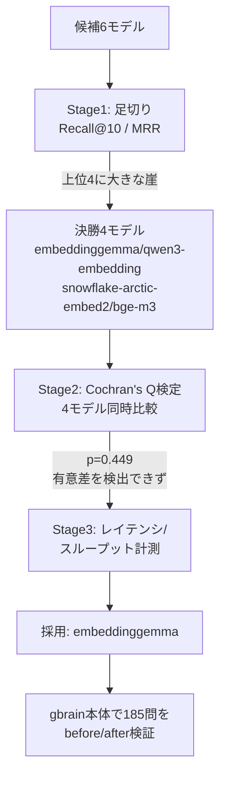

🔗 **検証コード・再現手順**: [github.com/yuya0408/gbrain-embedding-eval](https://github.com/yuya0408/gbrain-embedding-eval)

## この記事で分かること

gbrain(個人のローカル環境でRAG的なナレッジ基盤を動かせるOSS)の埋め込みモデルを、既定の`nomic-embed-text`から自前で選んだモデルに差し替え、gbrainへの質問がどれだけ当たるようになったかを検証した。**6候補を足切り → 上位4候補は統計的に有意差を検出できず → 決着はスループットという測れる指標に委ねた → `embeddinggemma`を採用し、gbrain本体での検索精度(MRR)がほぼ倍になった。**



### 用語

| 用語 | 意味 |
| --- | --- |
| Recall@10 | 正解が上位10件に入ったクエリの割合 |
| MRR | 正解の順位の逆数の平均。1位なら1、2位なら0.5 |
| hit@k | クエリごとに、正解が上位k件に入ったかの当たり／外れ |
| Cochran's Q検定 | McNemar検定のk群版。同じクエリに対する複数モデルの当たり／外れを同時に比べる |
| curated／auto | 手で作ったクエリ／チャンク本文からLLMに生成させた合成クエリ |

## 1. gbrainと、差し替えた場所

**gbrainは3段構えの検索を備えたナレッジ基盤を`gbrain init`だけで立ち上げられるOSSで、埋め込みモデルだけが差し替え可能なプラグイン点として残されている。** Y CombinatorのCEOであるGarry Tan氏が公開しているナレッジランタイムだ([GitHub](https://github.com/garrytan/gbrain))。

| 項目 | 内容 |
| --- | --- |
| 売り | ヒットしたページを返すだけでなく、複数ページを横断して合成した回答を、出典と「まだ分かっていないこと」の注記つきで返す |
| 土台 | Postgres+pgvector(ローカルはDocker不要のPGLite) |
| 検索 | ベクトル検索とキーワード検索のハイブリッド＋書き込み時に自動配線されるナレッジグラフ |
| 使い方 | Claude CodeなどにMCPサーバーとして接続し、`gbrain search`/`gbrain think`でエージェントの記憶層にする |
| 肩代わりしてくれる部分 | チャンク分割、ベクトルDBのスキーマ、ハイブリッド検索の配線 |
| 差し替えられる部分 | 埋め込みモデル。Ollama向けレシピの既定は`nomic-embed-text`(768次元)で、「とりあえず動く」ための選択 |

## 2. 条件

| 項目 | 内容 |
| --- | --- |
| コーパス | 個人で運用している複数リポジトリのメモ・記事など521チャンク |
| クエリ | 185件。curated 35問(正解はページ＝slug一致)、auto 150問(全体の81%、`qwen3.5:4b`で生成、正解は`chunk_id`の完全一致) |
| 候補 | Ollama公式ライブラリの埋め込みモデル6つ |
| 計測環境 | ノートPC(AMD Ryzen 5 7520U・メモリ16GB、専用GPUなしのCPU推論)、Ollama常駐 |

**合成クエリが8割を占めるため、Recall/MRRの絶対値は実利用より高めに出る。この評価はモデル間の相対順位を見るものだ。** autoはLLMが1チャンクだけを見て作った質問なので、答えの段落との意味的な近さが人間の質問より高い。

| 種別 | クエリの例(同じ記事のページが正解) | 正解の判定単位 |
| --- | --- | --- |
| curated | 「分散学習にするとメモリ不足のエラーが見えなくなることがあるのはなぜ？」 | ページ全体(slug一致) |
| auto | 「分散実行時、単ノードでは明示的なメモリ不足エラーが出ても、どうして別のノードでは原因不明のハングとして現れるのか。」 | 特定の1チャンク(chunk_id完全一致) |

## 3. 埋め込みモデルの比較

**品質では上位4モデルを統計的に区別できず、スループットで決着させて`embeddinggemma`を採用した。**

### Stage1: 足切り(Recall@10 / MRR)

**上位4モデルと既定の`nomic-embed-text`の間にMRRで0.306ポイントの崖があり、ここを足切りの基準にした。**

| モデル | Recall@10 | MRR |
| --- | --- | --- |
| embeddinggemma | 0.919 | **0.741** |
| qwen3-embedding | 0.908 | 0.731 |
| snowflake-arctic-embed2 | 0.886 | 0.705 |
| bge-m3 | 0.908 | 0.700 |
| nomic-embed-text(既定) | 0.632 | 0.394 |
| all-minilm | 0.314 | 0.149 |

### Stage2: 決勝4モデルの有意差検定

**4モデル間に統計的な有意差は検出できなかった(p=0.449)。** 決勝4モデルのhit@10を同じ185問で揃え、Cochran's Q検定にかけた。

```
hit@10: Q = 2.6512, df = 3, p = 0.4486
hit@1 : Q = 4.26,   df = 3, p = 0.235 （事後的な追加の検定）
```

| 留保 | 内容 |
| --- | --- |
| 同等の証明ではない | 「このNでは差を検出する力がなかった」までの結論 |
| hit@10は上限付近 | 4モデルとも0.886〜0.919に張り付き、片方だけ当たるクエリが少ない。順位差に敏感なhit@1でも結果は変わらなかった |

事前に決めた設計どおり、次段のタイブレーカーに進んだ。

### Stage3: レイテンシ/スループットで決着

**単発レイテンシは横並びで、差はバッチスループットにだけ出た。embeddinggemmaは2位以下の2.4〜6.5倍速い。**

| 計測 | やり方 |
| --- | --- |
| 単発クエリのレイテンシ | 短いクエリ1件を15回連続で投げ、中央値を取る |
| バッチのスループット | コーパスから200チャンクを、gbrain本体の送信単位と同じbatch=100で流し込む(各1回) |

| モデル | パラメータ | 次元 | 単発(中央値,ms) | 200件バッチ(s) | スループット(chunks/s) |
| --- | --- | --- | --- | --- | --- |
| qwen3-embedding | 596M | 1024 | 2076 | 683.4 | 0.29 |
| **embeddinggemma** | **308M** | **768** | 2104 | **105.8** | **1.89** |
| snowflake-arctic-embed2 | 567M | 1024 | 2199 | 256.5 | 0.78 |
| bge-m3 | 567M | 1024 | 2195 | 254.9 | 0.78 |

単発の中央値は、パラメータ数が308M〜596Mとばらつくのに差が6%以内で、候補を区別できない(固定コストの要因は切り分けていない)。スループットは、モデルを切り替えたときの全件再埋め込み(`gbrain migrate-embeddings`)と初回取り込みに直接効くので、これを決定打にした。

```
521チャンクの再埋め込み: embeddinggemma 約5分 / qwen3-embedding 約30分
```

品質の点推定でも最上位(Recall@10=0.919, MRR=0.741)、パラメータ数も4候補中最小(308M)であることも踏まえ、embeddinggemmaを採用した。

## 4. gbrain本体での検証

**オフラインで選んだ差し替えは、本番のgbrainパイプラインを通してもMRRを0.336から0.676へほぼ倍にした。** 同じ185問を、既定と差し替え後のそれぞれでgbrainへ投げ、正解が返ってきた順位を記録した。

| 指標 | nomic-embed-text(既定) | embeddinggemma(選定後) |
| --- | --- | --- |
| hit@1 | 25.9% (48/185) | **58.9%** (109/185) |
| hit@3 | 36.8% (68/185) | **74.6%** (138/185) |
| hit@10 | 50.3% (93/185) | **79.5%** (147/185) |
| MRR | 0.336 | **0.676** |
| 圏外(該当なし) | 92/185 | 38/185 |

hit@10で片方だけ当たったクエリはembeddinggemma側57件・nomic側3件で、exact McNemar検定でp<10⁻¹³だ。`nomic-embed-text`がgbrainのOllama向けレシピの既定であることは公式ドキュメントで確かめてあり、恣意的に選んだ弱い相手ではない。

実測MRRはオフライン(0.741)より低い0.676だった。

| | オフラインの評価 | gbrain本体 |
| --- | --- | --- |
| 見ているもの | 埋め込みベクトルのコサイン類似度top-kだけ | キーワード検索(BM25)とベクトル検索の融合、クエリ展開を含むパイプライン全体 |
| MRR | 0.741 | 0.676 |

このずれは、埋め込みモデル単体の評価と実運用の間で避けられない。

## まとめ

**既定値のまま動く便利なツールでも、埋め込みモデルは自分のナレッジとクエリに合わせて選ぶ価値があり、差し替えるだけでgbrain本体でのMRRは0.336から0.676へほぼ倍になった。** 検証は、足切り(Recall/MRR)→有意差検定(Cochran's Q)→測れる指標での決着(スループット)→実パイプラインでの再検証、の4段で行った。
<!-- gbrain: [Source: User, 記事執筆・公開, 2026-09-30] -->
