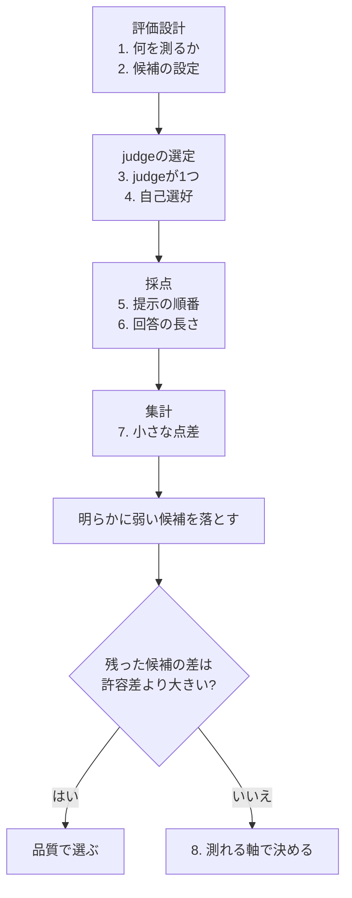
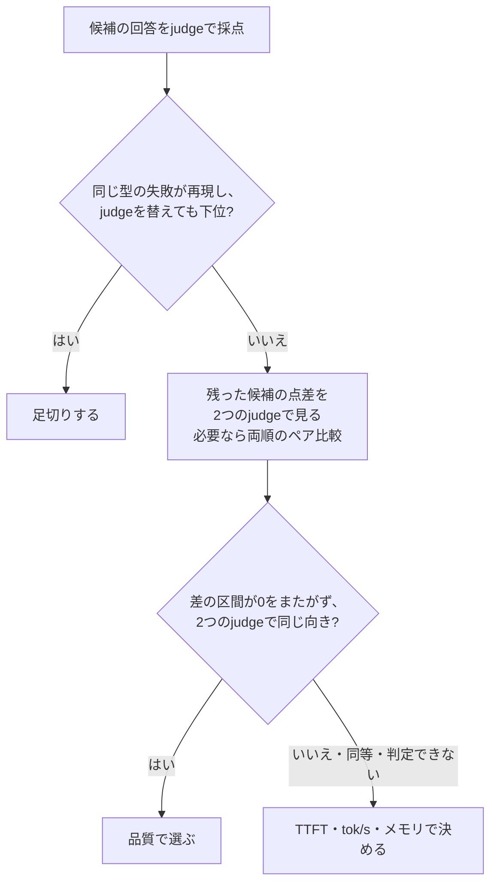

## この記事で分かること

LLMの出力を別のLLMに採点させるLLM-as-Judgeは、人手評価より速く安く数値が出る。**その数値で信頼できるのは「明らかに弱い候補を落とす」判断までで、接戦の候補の順位付けには使えない。**



想定する場面はRAGの生成モデル選定で、数値と回答例は説明のための架空のもの(論文の数値は除く)。すぐ使いたいなら「節ごとの要点」と最後のチェックリストへ。

### 節ごとの要点

| 節 | 誤りやすいこと | 知っておくこと |
| --- | --- | --- |
| 1 | 何を測るかを決めずに採点させる | 点ごとの意味を定義し、judgeに参照解答を渡す。失敗モードを再現するケースを入れる。足切りの根拠は平均点ではなく失敗の再現 |
| 2 | 候補の推論設定を記録しない | 候補ごとに本番で使う設定で評価し、thinking・温度・最大トークン・チャットテンプレートを記録する |
| 3 | judgeを1つしか使わない | judgeを替えると中位の順位が入れ替わりうる。使えるのはjudgeを替えても動かない情報だけ |
| 4 | 自己選好バイアス | 候補に含まれるモデルをjudgeにしない。judgeは候補より非力でないこと |
| 5 | ペア比較の位置バイアス | 順序を入れ替えて2回採点し、両順で一致した勝ちだけを数える |
| 6 | 冗長性バイアス | 簡潔さの扱いをルーブリックに書き、同じ質問の中で点数と回答長の関係を見る |
| 7 | 1〜5点の小さな差を順位として読む | ケースごとの差の信頼区間を、事前に決めた許容差と比べる。数十ケースでは足りない |
| 8 | すべてをjudgeで決める | 品質がタイなら、TTFT・tok/s・メモリで決める |

### 用語

| 用語 | 意味 |
| --- | --- |
| LLM-as-Judge | LLMの出力の品質を、別のLLM(judge)に採点させる評価方法 |
| ルーブリック | 採点基準。点ごとの意味と採点軸を文章で定めたもの |
| アンカー | ルーブリックで各点に付ける、その点に当たる回答の説明 |
| 参照解答 | judgeに渡す、その質問の期待する回答 |
| 絶対採点／ペア比較 | 1つの回答に1〜5点を付ける方式／2つの回答のどちらが良いかを選ばせる方式 |
| 失敗モード | 誤りの型。同じ型の誤りが繰り返し出るかを見る |
| answerable but refused | 資料に答えがあるのに「記載が無い」と答える失敗 |
| hallucination | 資料に無い答えをでっち上げる失敗 |
| multi-hop | 複数のチャンクを突き合わせないと答えられない質問 |
| 天井効果 | 上位の候補が満点近くに集まり、差がつかなくなること |
| ブートストラップ | ケースを復元抽出して統計量を繰り返し計算し、ばらつき(信頼区間)を見積もる方法 |
| 許容差(等価マージン) | これより小さい差なら同等とみなす、と採点の前に決める幅 |
| 多重比較の補正(Bonferroni・Holm法) | 複数のペアを比べるとき、どれかで偶然「差がある」と出る確率を抑える補正 |
| 位置バイアス | ペア比較で、提示の順番によって採点が偏る傾向。MT-Benchの論文では、似た回答2つの順序を入れ替えたとき、GPT-4の判定が揃ったのは65.0%で、30.0%は先に出した方を勝たせた |
| inconsistent | 順序を入れ替えた2回の判定が食い違ったケース |
| 自己選好バイアス(self-preference) | judgeが自分の出力を高く採点する傾向 |
| 冗長性バイアス(verbosity) | 回答の長さに採点が引っ張られる傾向 |
| TTFT／tok/s | 送ってから最初の1トークンが返るまでの時間／1秒あたりの生成トークン数 |

## 前提

| 項目 | 想定 |
| --- | --- |
| 場面 | RAGの回答を生成するモデルを、複数の候補から1つ選ぶ |
| 候補 | 4つ |
| 評価セット | 約90〜120ケース(差の標準偏差0.5・許容差0.15の場合。7節の式)。質問の系統は1節の表 |
| 採点 | 1〜5の絶対採点(4軸、1節)。接戦の候補はペア比較(5節) |
| judgeの置き場所 | 社内文書を外部のAPIに送れないなら、ローカルのモデルになる。4節の「候補より非力でない」を満たすモデルが手元で動くかを先に確かめる |

---

## 1. 何を測るか：基準を決めずに採点させる

**点ごとの意味と採点軸を決めずに「1〜5で採点して」と頼むと、測れるのは回答の品質ではなくjudgeの好みになる。**

### ルーブリックと参照解答

各点にアンカーを付けるだけで、採点のブレは減る。

```text
5 = 基準を完全に満たす
4 = 正しく、軽微な不足のみ
3 = 正しいが、必要な情報の一部が欠ける
2 = 重要な誤りや欠落がある
1 = 不正解、または基準に反する
```

採点軸も分解する。RAGの生成なら次の4軸だ。

| 採点軸 | 見ること |
| --- | --- |
| 文脈忠実性 | 渡した文脈が支持することだけを答えているか |
| 日本語の自然さ・正確さ | 冗長さや不自然な言い回しがないか |
| ドメイン指示との整合 | システムプロンプトで与えた方針・制約を守っているか |
| 指示追従・構造化出力 | 指定した出力形式を守れているか |

judgeには質問・渡した文脈・候補の回答に加えて、参照解答を渡す。judgeは自分で解ける問題でも、候補の回答に引きずられて誤判定する。MT-Benchの論文では、数学の10問(順序を入れ替えて20回)でGPT-4が誤答を正しいとしたのは、参照なしで14/20、参照ありで3/20だった。

### 失敗モードを再現するケース

RAGの生成モデルに問われるのは知識量ではなく、渡された文脈への忠実性だ。だから評価セットは、典型的な失敗を引き出すように作る。

| 質問の系統 | 問われる能力 | 典型的な失敗モード |
| --- | --- | --- |
| 回答可能(資料に答えがある) | 文脈から正しく抽出する | answerable but refused |
| 回答不能(資料に答えがない) | 「資料にない」と正直に言う | hallucination |
| 条件・例外つき | 条件を正確に適用する | 条件を無視して一般化する |
| 複数箇所の統合(multi-hop) | 複数のチャンクを突き合わせる | 片方だけ見て早合点する |
| 数値・固有名詞 | 値や名称を正確に転記する | 桁・単位・名称を取り違える |

上の2行は表裏の関係で、RAGでいちばん重い失敗にあたる。answerable but refusedの例は次の通り。

| 項目 | 内容 |
| --- | --- |
| 文脈 | 「本製品の保証期間は、購入日から2年間とする。ただし消耗品は対象外とする。」 |
| 質問 | 保証期間はどのくらいですか? |
| 期待する回答 | 購入日から2年間(消耗品は対象外) |
| 候補の回答 | 「ご提示の資料には、保証期間に関する記載が見当たりませんでした。」 |

**この誤りを繰り返すモデルでも、他の質問で高得点を取れば、平均点の順位では中位に収まることがある。** だから足切りの根拠には、平均点ではなく同じ型の失敗が再現するかを使う。「再現する」の基準(例: 回答可能の質問で answerable but refused が何件以上)は採点の前に決め、該当したケースは人が回答を読んで確かめる。

## 2. 候補の設定：推論設定の差をモデルの差と取り違える

**候補ごとに本番で使う推論設定で評価し、その設定を記録する。** 温度などを全候補で同じ値にすると、推奨値から外れて不利になる候補が出る。judgeの問題ではないが、設定ひとつで品質スコアも速度も変わる。

| 設定 | 評価に効くこと |
| --- | --- |
| thinkingの有無 | 既定でオンのモデルがあり、RAGでは出力に余計な前置きが混ざったり、速度が大きく落ちたりする |
| 温度 | 高いと同じ質問でも回ごとに回答が変わり、採点がぶれる |
| 最大トークン | 小さいと長い回答が途中で切れ、減点される |
| チャットテンプレート | モデルが想定しない形式で入力が渡ると、品質が落ちる |

## 3. judgeが1つ：judgeのクセが順位を動かす

**judgeを替えると中位の順位が入れ替わりうる。意思決定に使えるのは、judgeを替えても動かない情報だけだ。** MT-Benchの論文も、judgeを替えたとき絶対採点の点数は、ペア比較の結果より揺れやすいとしている。

| 候補 | judge A 総合 | judge B 総合 |
| --- | --- | --- |
| 候補1 | 4.60(1位) | 4.65(1位) |
| 候補2 | 4.50(2位) | 4.35(**3位**) |
| 候補3 | 4.40(3位) | 4.55(**2位**) |
| 候補4 | 4.25(4位) | 4.10(4位) |

この例では首位と最下位は動かず、候補2と候補3が入れ替わる。judge Aは候補3の長めの回答を冗長として減点し、judge Bはそこを気にしない、というクセ(6節)があればこうなる。judgeは中立の物差しではない。

対策は、系統の異なる2つ目のjudgeでクロスチェックし、点数そのものではなく順位がjudgeに依存しないかを見ることだ。「両judgeとも最下位」のような動かない情報は、足切りに使える。

## 4. judgeの選び方：自己選好バイアス

**候補に含まれるモデルはjudgeにしない。** Panicksseryらは、GPT-4とLlama 2が、人が同等と判断した回答でも自分の出力を高く採点し、自分の出力を見分けられるほどその傾向が強まることを示した。MT-Benchの論文では、GPT-4は自分の勝率を人の判定より10%、Claude-v1は25%高く付けたが、データが少なく自己強化バイアスがあるとは断定できない、としている。

| judgeの候補 | 起こること | 対策 |
| --- | --- | --- |
| 候補そのもの | 自分の出力を高く採点する | judgeにしない |
| 候補と同じファミリーの大型版 | 出力の書き方が似るので、同じ偏りが懸念される(直接の根拠は見つけていない) | 別系統のjudgeでの順位と比べ、特定の候補だけ順位が上がっていないかを見る |
| 候補より非力なモデル | 細部の誤りを見抜けない | judge自身にも評価セットを解かせ、候補より誤りが少ないことを確かめる |

## 5. ペア比較：位置バイアスを無視する

**ペア比較は1ケースにつき順序を入れ替えて2回採点し、両順で一致した勝ちだけを勝ちと数える。** MT-Benchの論文によれば、絶対採点は特定のペアの細かい差を見分けにくく、接戦の候補にはペア比較が向く。ただしjudgeには位置バイアスがある。

```text
(A, B) で A勝ち かつ (B, A) で A勝ち → A勝ち
(A, B) で tie  かつ (B, A) で tie  → tie
(A, B) と (B, A) で判定が食い違う   → inconsistent
```

MT-Benchの論文はinconsistentをtieとして数える。ここでは位置バイアスの大きさを見るために、tieと分けて数える。接戦の2候補では、tieとinconsistentが大半を占めることも珍しくない。それ自体が「品質では差がつかない」という結果だ。judgeのクセはペア比較でも残るので、2つのjudgeで結論が揃うかも見る(3節)。

## 6. 回答の長さ：冗長性バイアスに気づかない

**judgeは回答の長さに引っ張られる。** MT-Benchの論文では、内容を足さずに箇条書きを言い換えて水増しした回答(23件)を、Claude-v1とGPT-3.5は91.3%、GPT-4は8.7%で元の回答より良いと判定した。逆にルーブリック次第で長い回答を低くするjudgeもあり、3節の順位の入れ替わりの原因になりやすい。

| 確かめること | 方法 |
| --- | --- |
| 簡潔さの扱い | 冗長さを減点するのか、しないのかをルーブリックに書く |
| 長さとの関係 | 同じ質問への候補どうしの回答で、長い方が高く採点される割合を見る。全質問をまとめた相関だと、multi-hopのように長い回答が本当に良い質問の影響と混ざる |

## 7. 集計：1〜5点の小さな差を順位として読む

**絶対採点では上位が4点台に張り付き(天井効果)、候補どうしの差は0.1〜0.2点に縮む。数十ケースでは、この差があるとも同等とも言えない。**

全候補が同じケースを採点されるので、各候補の平均点の区間が重なるかではなく、ケースごとの点差(対応のある差)で見る。各候補の区間が重なっていても、差は有意なことがある。

```text
仮定: ケースごとの点差(候補A − 候補B)の標準偏差 0.5、許容差 δ = 0.15

30ケース: 差の平均の標準誤差 = 0.5 / √30 = 0.091
          95%信頼区間の半幅   = 1.96 × 0.091 = ±0.18  (> δ なので同等も示せない)

必要なケース数の目安(検出力80%):
  差δを見分ける                     n ≈ ((1.96 + 0.84) × 0.5 / 0.15)² = 87
  同等を示す(真の差0、95%区間が±δに収まる) n ≈ ((1.96 + 1.28) × 0.5 / 0.15)² = 117
```

許容差δは採点の前に決め、ケースごとの点差をブートストラップした95%信頼区間で判定する。4候補を総当たりで比べると6ペアになり、偶然「差がある」と出やすいので、多重比較の補正をする(区間で見るならBonferroniで各ペアを1 − 0.05/6 ≈ 99.2%の区間に広げる。p値で見るならHolm法)。上の必要ケース数は1ペアでの目安で、補正するとさらに増える。

| 差の95%信頼区間 | 判定 |
| --- | --- |
| 0をまたがない | 差がある |
| −δ〜+δの内側に収まる | 同等(タイ) |
| どちらでもない | 判定できない(ケースを増やすか、タイとして8節へ) |

```python
import numpy as np

def bootstrap_diff_ci(scores_a, scores_b, n_boot=10_000, alpha=0.05, seed=0):
    rng = np.random.default_rng(seed)
    diff = np.asarray(scores_a) - np.asarray(scores_b)  # 同じケースどうしの点差
    means = rng.choice(diff, (n_boot, len(diff)), replace=True).mean(axis=1)
    return np.quantile(means, [alpha / 2, 1 - alpha / 2])
```

## 8. 決着：すべてをjudgeで決めようとする

**品質がタイと分かったら、測れば揺るがない軸に判断を移す。** 本番の運用形態(常駐させるのか、都度ロードするのか)に合わせて、複数回測った中央値を取る。

| 指標 | 見ること |
| --- | --- |
| TTFT | 初回応答までの時間 |
| tok/s | 生成速度 |
| 常駐メモリ・コスト | 載せるのに要る資源 |

---

## まとめ：judgeを使う前のチェックリスト

| 確かめること | 確かめ方 | 節 |
| --- | --- | --- |
| ルーブリックに点ごとの意味がある | 1〜5の各点にアンカーを付ける | 1 |
| judgeに参照解答を渡している | 質問・文脈・回答に加えて、期待する回答を渡す | 1 |
| 失敗モードを再現するケースがある | 回答可能・回答不能・条件つき・multi-hop・数値の5系統を入れ、足切りの基準を先に決める | 1 |
| 候補の推論設定を記録した | 本番の設定で評価し、thinking・温度・最大トークン・テンプレートを書き残す | 2 |
| 順位がjudgeに依存しない | 系統の違う2つ目のjudgeで順位を比べる | 3 |
| judgeが候補そのものでない | 候補に含まれるモデルを外す。同ファミリーなら別系統のjudgeと順位を比べる | 4 |
| judgeが候補より非力でない | judge自身に評価セットを解かせる | 4 |
| ペア比較の位置バイアスを除いた | 両順で採点し、inconsistentを分けて数える | 5 |
| 長さで採点されていない | 同じ質問の中で、長い回答が高く採点される割合を見る | 6 |
| ケース数が足りている | 許容差と差の標準偏差から、7節の式で見積もる | 7 |
| 小さな点差を順位として読んでいない | 差の信頼区間を0と許容差の両方と比べ、多重比較の補正をする | 7 |

## judgeの使い分け



| judgeの扱い | 場面 | 根拠 |
| --- | --- | --- |
| 使う | 明らかに弱い候補を落とす | 失敗モードの再現(1節)。judgeを替えても動かない(3節) |
| 使わない | 接戦の細かい順位付け | 点差がノイズに埋もれる(7節)。judgeで順位が動く(3節) |
| 委ねる | 品質がタイ | 測れる軸は揺るがない(8節) |

## 出典

- Zheng et al., "Judging LLM-as-a-Judge with MT-Bench and Chatbot Arena", NeurIPS 2023 Datasets and Benchmarks Track：https://arxiv.org/abs/2306.05685v4 (3.1節 採点方式の比較、3.3節 Table 2〜4 位置・冗長性・自己強化バイアスと数学の採点、3.4節 順序の入れ替えと参照つき採点)
- Panickssery, Bowman, Feng, "LLM Evaluators Recognize and Favor Their Own Generations" (2024)：https://arxiv.org/abs/2404.13076v1 (自己選好バイアス)
