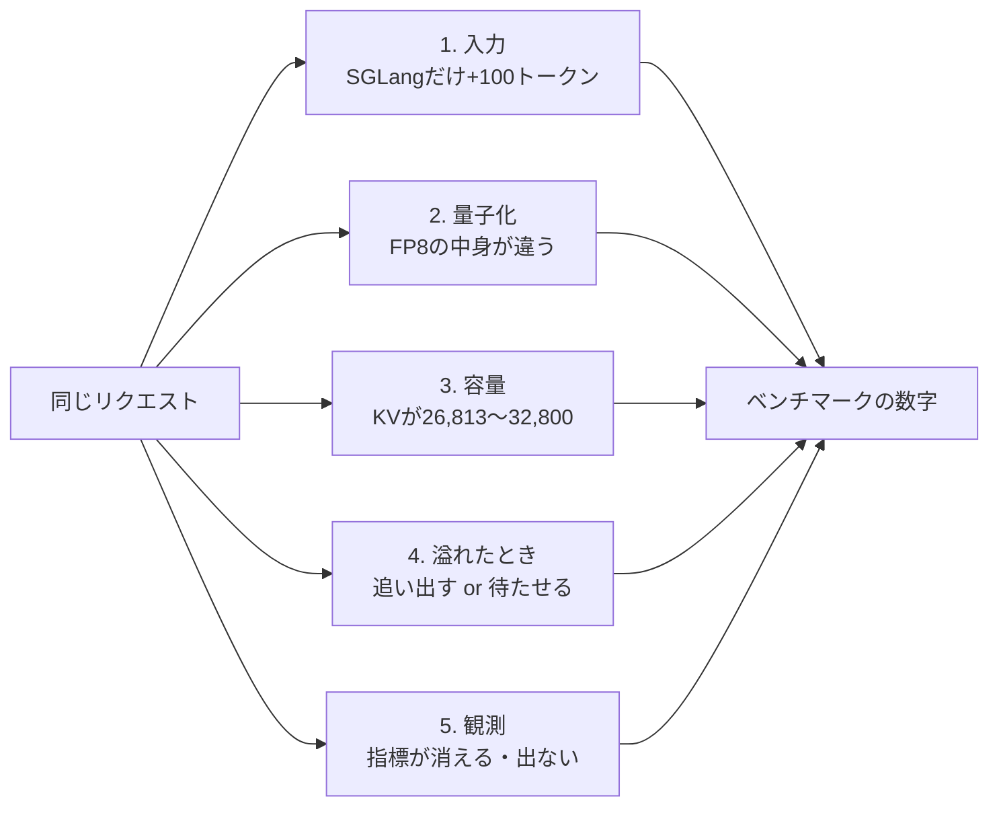
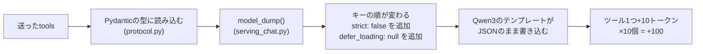
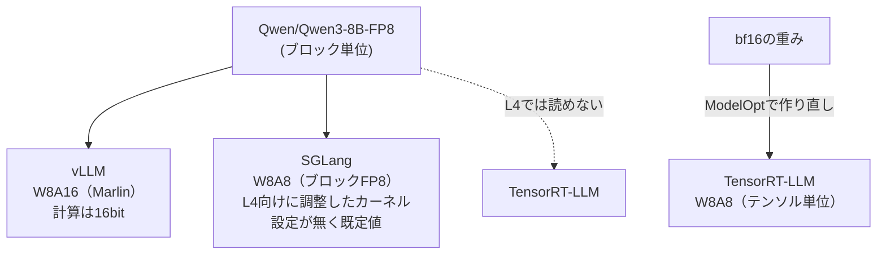
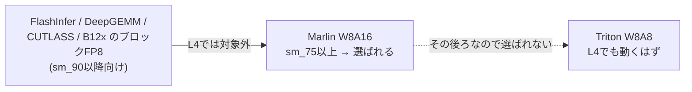
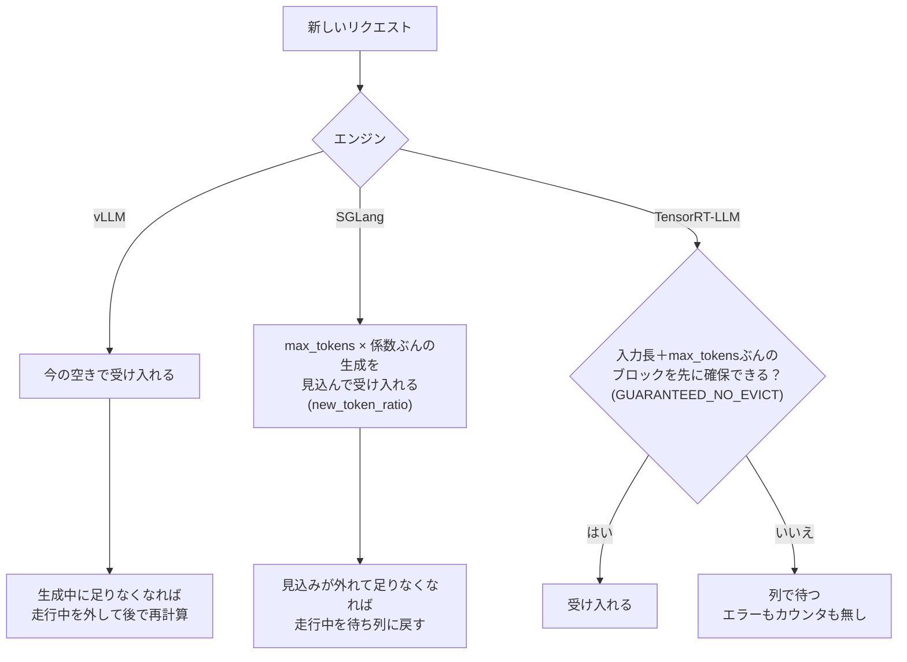
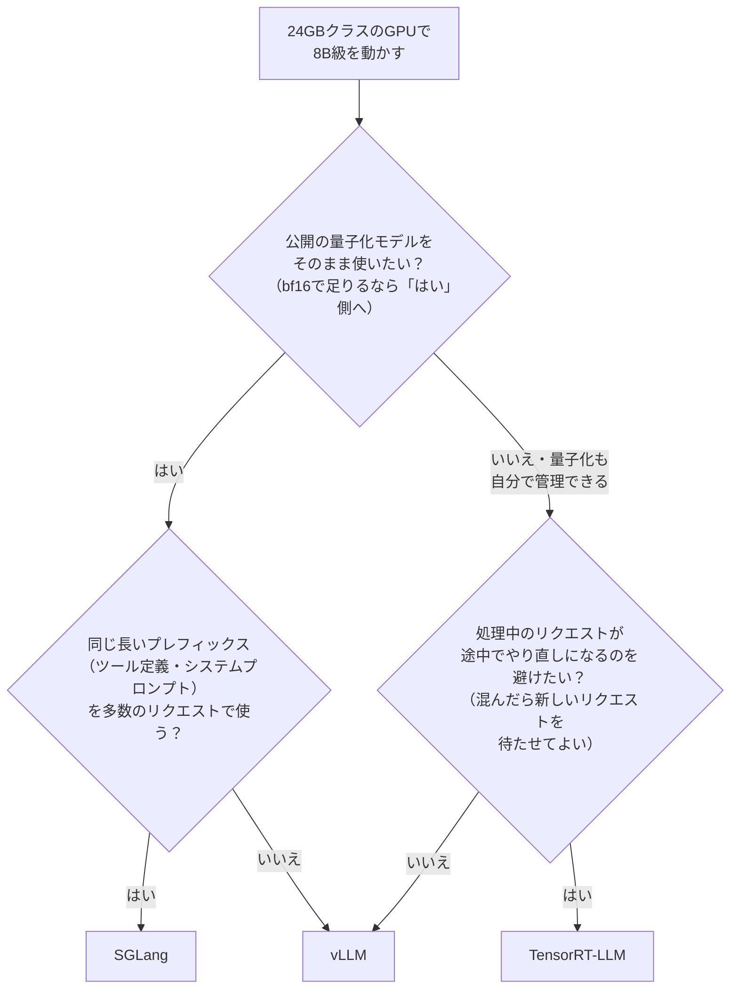

## この記事で分かること

Qwen3-8Bを、L4 24GB 1台の上でvLLM・SGLang・TensorRT-LLMに載せ、同じリクエストを送った。揃えたつもりの条件が、5か所で揃っていなかった。どれもベンチマークの数字に入り込む。



速さの順位は載せない（速さは自分の条件で測ってほしい）。すべてこの版・L4（sm_89）での話である。エンジンを選びたいだけなら「エンジン別の要点」と最後の「私の使い分け」へ。

### エンジン別の要点

| エンジン | 知っておくこと |
| --- | --- |
| vLLM 0.31.0 | L4では`Qwen/Qwen3-8B-FP8`が重みだけFP8（W8A16）で動く |
| SGLang 0.5.21 | ツール定義に項目が足され、入力が増える。L4・8B bf16は`--mem-fraction-static`の自動値では起動しない（0.87で動いた） |
| TensorRT-LLM 1.2.1 | L4では`Qwen/Qwen3-8B-AWQ`・`-FP8`をそのまま読めない。KVが足りないと黙って待たせる。キャッシュを消すAPIが無い |

### 用語

| 用語 | 意味 |
| --- | --- |
| KVキャッシュ | 生成中のリクエストが、それまでのトークンの計算結果を置いておくGPUメモリ。容量をトークン数で数え、同時に処理できる本数の上限を決める |
| プリフィル | 入力（プロンプト）をまとめて読み込む最初の段階。入力が長いほど重い |
| TTFT | Time To First Token。送ってから最初の1トークンが返るまでの時間 |
| W8A16／W8A8 | 重み（Weight）と計算時の値（Activation）のビット数。W8A16は重みだけ8bitで計算は16bit |
| 追い出し（preemption／retraction） | KVが足りなくなったとき、処理中のリクエストをいったん外すこと。後でやり直す |
| RadixAttention | SGLangのプレフィックスキャッシュ。木構造で、任意のトークン位置まで一致を使い回す（vLLMは決まった長さのブロック単位） |
| sm_89／Ada／Hopper | NVIDIA GPUの世代。L4はAda（sm_89）、H100はHopper（sm_90） |
| ModelOpt | NVIDIAの量子化ツール。TensorRT-LLM向けの量子化モデルを作る |

## 条件

| 項目 | 値 |
| --- | --- |
| モデル | Qwen3-8B（bf16、AWQ 4bit、FP8） |
| GPU | NVIDIA L4 24GB 1台（sm_89、AWS `g6.xlarge`）。ドライバ 595.112.07、CUDA 13.2 |
| エンジン | vLLM 0.31.0 / SGLang 0.5.21 / TensorRT-LLM 1.2.1（`trtllm-serve`、PyTorchの経路） |
| リクエスト | `/v1/chat/completions`。ツール定義10個（ケースごとに40個から選ぶ）＋日本語の質問。システムプロンプトなし、thinkingオフ、質問の末尾にリクエストごとの識別子 |
| `max_tokens`／最大の文脈長 | 512／8,192 |
| 測った並行数 | AWQ・FP8は1と16。bf16は1（16は載らない：3節）。SGLang bf16は容量の確かめで8も |
| 送ったケース | 200ケースのうち20ケースを繰り返し送った（並行数1で80件） |
| プレフィックスキャッシュ | 3エンジンとも既定で有効。区切り（エンジン×チェックポイント×並行数×測定の種類）ごとにサーバーを起動し直す |

| エンジン別 | vLLM | SGLang | TensorRT-LLM |
| --- | --- | --- | --- |
| 入力長 最大／中央値（200ケース） | 2,591／2,310 | 2,691／2,410 | 2,591／2,310 |
| ツールパーサー | `hermes` | `qwen`（`Qwen25Detector`） | `qwen3` |
| バッチの上限 | `max_num_seqs` 256・`max_num_batched_tokens` 2048 | `max_running_requests` 2048 | `max_batch_size` 2048・`max_num_tokens` 8192 |
| チャンク化プリフィル | 有効 | 有効（4096） | 無効 |
| CUDA graph | `FULL_AND_PIECEWISE` | 有効 | バッチ1〜32・64・128 |

バッチの上限はどれも並行数16より大きい。

---

## 1. 入力：SGLangだけトークン数に差が出た

同じリクエストで`usage.prompt_tokens`を比べると、SGLangだけ全ケースで**+100トークン**だった。



```json
// 送ったもの（{…}は省略）
{"type": "function", "function": {"name": "search_master", "description": "…", "parameters": {…}}}
// テンプレートに渡るもの
{"type": "function", "function": {"description": "…", "name": "search_master", "parameters": {…}, "strict": false}, "defer_loading": null}
```

| エンジン | toolsの扱い | `prompt_tokens` |
| --- | --- | --- |
| vLLM | 型に通すが、テンプレートに渡す長さは変わらない | 送ったまま手元でテンプレートに通した長さと一致 |
| SGLang | `model_dump()`で項目を足し、キーの順が変わる | +100 |
| TensorRT-LLM | — | vLLMと一致 |

書き換えを再現する関数を書き、1,200件でSGLang自身の`model_dump()`と突き合わせて違いは0件だった。確かめるなら、テンプレート適用後の文字列（vLLMなら`/tokenize`）の差分を取る。

- **切り替えるオプションは無い。** 揃えるならクライアントから足した形で送る（他エンジンの入力も変わる）。今回はそのまま測った。
- **効き方**：プリフィルが重くなる／KVの見積もりがずれる（3節）／精度にも混ざる。ツールが多いほど差は大きい。パーサーも3つとも別の実装で、読み損ねは精度の差として出る。

---

## 2. 量子化：「FP8」が同じ意味ではない



| エンジン | 起動時の警告 |
| --- | --- |
| vLLM | `Weight-only FP8 compression will be used leveraging the Marlin kernel.` |
| SGLang | `Using default W8A8 Block FP8 kernel config. Performance might be sub-optimal!` |

「FP8で比べた」表は、重みだけ8bitと計算も8bitが混ざりうる。**起動ログのカーネル名で確かめる。**

vLLMがL4でW8A16になるのは、カーネルの候補を順に試し、最初に使えるものを選ぶため（`vllm/model_executor/kernels/linear/__init__.py`の`init_fp8_linear_kernel`）。



CUTLASSのブロックFP8のカーネルはsm_90・sm_100・sm_120向けしか無い（`csrc/.../c3x/scaled_mm_blockwise_sm*_fp8.cu`）。`--linear-backend`で変えられるはずだが試していない。

TensorRT-LLM 1.2.1・L4では、公開の次の2つを読めなかった。

| チェックポイント | 読めない理由 | 代わり（ModelOpt 0.37.0） |
| --- | --- | --- |
| `Qwen/Qwen3-8B-AWQ`（AutoAWQ形式） | `load_hf_quant_config`に`awq`の分岐が無い | `--qformat int4_awq` |
| `Qwen/Qwen3-8B-FP8`（ブロック単位） | 対応表で、ブロック単位FP8はAda（sm_89）が対応外（HopperとBlackwell sm100/103は対応）。モデル側の表でもQwen3は対応外なので、H100でも使えない | `--qformat fp8 --kv_cache_qformat none` |

2つで約56分かかった。`nvidia/Qwen3-8B-FP8`はKVまでFP8になるため使わなかった（KVの型の上書きは試していない）。TensorRT-LLMだけチェックポイントが別物なので、量子化した構成はエンジン間で比べず、各エンジン内でbf16との精度差だけ確かめた。

---

## 3. 容量：同じGPUでも載る量が違う

名前の似たメモリ設定が、**何に対する割合か**が違う（L4は約22.5GiB〔23,034MiB〕、Qwen3-8B bf16の重みは15.27GiB）。

```text
          |    weights    |      KV      |   act   | rest |
GPU       |===============|==============|=========|======|
vLLM      |<---------------- 0.92 ---------------->|
SGLang    |<----------- 0.87 ----------->|
TRT-LLM                   |<-------- 0.9 x free --------->|
```

act＝活性化など計算中の作業領域（プリフィルの中間結果、CUDA graph）。rest＝エンジンの外で使われる分の余白。模式図で、長さは比率どおりではない。

| エンジン | 割合の対象 | 割合に含むもの | 値 | KVの容量（トークン） | 容量を直接指定するなら |
| --- | --- | --- | --- | --- | --- |
| vLLM | GPU全体 | 重み＋KV＋活性化 | 0.92（既定） | 30,240 | `--kv-cache-memory-bytes`（指定すると0.92は無視される） |
| SGLang | GPU全体 | 重み＋KV（活性化は外） | 0.87（手で決めた） | 26,813 | `--max-total-tokens` |
| TensorRT-LLM | 重みと活性化を確保した後の空き | KVだけ | 0.9（既定） | 約32,800 | `kv_cache_config.max_tokens`（割合と両方なら小さいほう） |

揃えたいなら割合ではなくトークン数で直接指定する（オプション名は版で変わりやすい）。今回は既定に近い状態を測るため揃えていない。

```text
KV 1トークン = 36層 × KVヘッド8 × 128次元 × K/V 2 × 2バイト = 144KiB
1本の最大   = 入力2,691（SGLang） + max_tokens 512 + 余裕1 = 3,204
並行数8     = 3,204 × 8 = 25,632（+100前は 3,104 × 8 = 24,832）
並行数16    ≒ 51,300 → bf16は3エンジンとも載らない
```

全リクエストが最大長まで伸びても入るかで数え、入らない組み合わせは測っていない。

**SGLangは自動値（0.684）で起動しなかった。** 自動値＝（GPUの容量−作業領域の見積もり）÷GPUの容量（`srt/arg_groups/memory_hook.py`）。

| 作業領域の見積もり（L4） | 大きさ |
| --- | --- |
| 固定の分 | 512MiB |
| プリフィル | `chunked_prefill_size` 4,096トークン×1.5MiB＝6GiB（係数1.5はソースで「経験的な値」） |
| 並列化の分 | 128MiB（1GPU） |
| CUDA graph | デコードの最大バッチ48×2MiB＋プリフィルの分 |
| **合計** | **約7.1GiB（23,034MiB×(1−0.684)）** |

```text
ValueError: Loaded weights leave no GPU memory for the KV cache under --mem-fraction-static=0.684.
```

並行数8が載る値を0.01刻みで探した（0.01あたり約1,590トークン）。

| 割合 | KVの容量 | 並行数8（25,632） | KV以外の残り | 追い出し |
| --- | --- | --- | --- | --- |
| 0.684（自動） | 起動しない | — | — | — |
| 0.84 | 22,047 | 載らない | 1.82 GB | — |
| 0.86 | 25,224 | 載らない | 1.40 GB | — |
| 0.87 | 26,813 | 載る | 1.11 GB | 0回 |

+100前なら0.86で足りたが、1節の+100で408トークン足りなくなり0.87にした。0.88以上は試していない。

---

## 4. 溢れたとき：追い出すか、黙って待たせるか



| 方式 | エンジン | 混んだとき遅れる場所 | 見える指標 |
| --- | --- | --- | --- |
| 追い出す | vLLM・SGLang | 生成の途中（ストリーミングが止まる） | `vllm:num_preemptions`／`sglang:num_retracted_requests_total` |
| 待たせる | TensorRT-LLM | 最初の1トークン（TTFT） | 無い。`numActiveRequests`で見る |

TensorRT-LLMは「入力長＋`max_tokens`」ぶんを先に確保するので、`max_tokens`を大きく付けるほど同時に受け入れる本数が減る。並行数16で送っても中では8本しか走っていないことがある。空きに合わせて詰め込む`MAX_UTILIZATION`もある（処理中のリクエストが一時停止しうる。試していない）。

今回は`/metrics`を2秒ごとに読み、`numActiveRequests`の最大が送った本数に届いたことを確かめた。溢れる組み合わせは測っていない（3節）。

---

## 5. 観測：そのまま読むと誤判定になる

| エンジン | 癖 | 対処 |
| --- | --- | --- |
| SGLang | キャッシュヒットが0だと`prompt_tokens_details`ごと出ない | 無ければ0 |
| SGLang | `num_retracted_requests_total`は初回の追い出しまで出ない | ゲージ`num_retracted_reqs`があれば0回 |
| TensorRT-LLM | `kvCacheStats`は`enable_iter_perf_stats`が要り、1件処理するまで空 | 短いリクエストを1件送ってから読む |
| TensorRT-LLM | その1件で、測定の最初のリクエストが`cached_tokens`=1になった（`<\|im_start\|>`を共有。partial reuseが既定で有効なので、32トークンのブロックの一部でも当たる） | 書式を通さない`/v1/completions`で送る |
| TensorRT-LLM | 反復ごとの統計は読むたびに消える | 測定中に2秒ごとに読む |

「読めなければ0」にしていたら誤った結論を出していた。「読めなければ止める」作りにしていたので気づけた。

| エンジン | キャッシュの消し方 |
| --- | --- |
| vLLM | `POST /reset_prefix_cache`（`VLLM_SERVER_DEV_MODE=1`） |
| SGLang | `POST /flush_cache` |
| TensorRT-LLM | APIなし。再起動 |

キャッシュがどれだけ効くかは、送るケースの数とKVの容量で大きく変わる。今回は20ケース（入力の合計45,957トークン）を繰り返し送った。

| チェックポイント | KVの容量（トークン） | 20ケースぶんが | `cached_tokens`／入力（3エンジンとも同程度） |
| --- | --- | --- | --- |
| bf16 | 26,813〜32,800 | 収まらず、一周する前に追い出される | 3.6〜4.7%（当たるのは先頭の書式 約50トークンだけ） |
| AWQ・FP8 | 76,096〜99,552 | 収まり、2周目からツール定義ごと当たる | 並行数1で約75%、16で約82% |

200ケースすべてを送った本番の測定では、どの構成も4.7〜9.0%だった。

効いているのは並行数ではなく、量子化で空いたKVの容量である。量子化した構成の速さには、計算が軽くなった分とキャッシュに当たった分が混ざりうる。ケースの数・繰り返し方とKVの容量を並べて確かめたい。

---

## 6. 動かすまで

版がぶつかるので、仮想環境をエンジンごとに分け、クライアントはHTTPだけで話す。

| エンジン | torch | transformers |
| --- | --- | --- |
| vLLM | 2.13.0+cu132 | 5.17.0 |
| SGLang | 2.13.0 | 5.12.1 |
| TensorRT-LLM | 2.9.1+cu130 | 4.57.3 |

| 問題 | 対処 |
| --- | --- |
| TensorRT-LLM環境でModelOptが動かない（NumPy<2固定と最新pyarrowが衝突） | `pyarrow<22` |
| TensorRT-LLM FP8が起動中にsegfault（原因不明、再実行で通過） | — |
| そのとき親プロセスが残り、20分待ち続けた | ログに`Segfault encountered`等が出たら即失敗にして1回だけ再起動 |

---

## まとめ：比較を作る・読むときのチェックリスト

| 確かめること | 確かめ方 |
| --- | --- |
| モデルに届く入力は同じか | `usage.prompt_tokens`を並べる。テンプレート適用後の文字列を比べる |
| ツールパーサーは何か | 起動オプションを書く |
| 量子化の計算は何か | 起動ログのカーネル名・警告 |
| 量子化のチェックポイントは同じか | 対応表とソースで、使うGPUで読める形式か確かめる |
| KVの容量はいくつか | 割合ではなくトークン数で見る。揃えるなら直接指定する |
| 溢れたら何が起きるか | 追い出しカウンタと同時実行数。`max_tokens`も書く |
| 指標が読めないときの扱い | 読めなければ止める |
| キャッシュの状態 | 有効か、区切りごとに消すか、`cached_tokens`はいくつか。ケースの数・繰り返し方とKVの容量も書く |

## 私の使い分け（推奨案）

速さではなく、導入の手間・設定の素直さ・観測しやすさで決めた。

**当てはまる範囲**：24GBクラスのGPU1台・8B級・同時8本程度まで。大きいGPUや70B級ではメモリ（3節）と量子化の対応（2節）が変わる。



| 推奨 | 想定するユースケース | 決め手 | 気をつけること |
| --- | --- | --- | --- |
| **vLLM** | 社内チャットやRAGのPoC。公開モデル（量子化版を含む）を差し替えて評価する | 公開チェックポイントをそのまま読める（2）。既定の設定で起動し、追い出しがカウンタで見える（3・4） | L4のFP8はW8A16（2） |
| **SGLang** | 同じツール定義・システムプロンプトを先頭に付けるエージェントやバッチ処理 | RadixAttention（用語）。L4でもFP8がW8A8（2）。※今回は共有部分が短く、実測ではない（5） | 入力が増える（1）。割合を手で決める（3）。指標が0で出ない（5）。共有部分の長い順に処理する`lpm`は既定ではない（既定`fcfs`）。別の本番の測定では、精度の足切りで3構成とも非劣化を示せなかった（劣るとまでは言えない。入力の+100が原因と見ているが切り分けていない） |
| **TensorRT-LLM** | モデルを固定して長く運用する本番API | 処理中のリクエストが途中でやり直しにならない（4）。量子化は最初の1回で済む | 量子化を作り直す（2）。混むとTTFTが伸びるので、SLAがTTFTなら自分で測る（4）。キャッシュを消すAPIなし（5） |

迷ったらvLLMで基準を作り、チェックリストで条件を揃えてから他と比べる。

## 付録：起動コマンド

```bash
# vLLM 0.31.0（bf16。AWQ・FP8はモデル名だけ替える。VLLM_SERVER_DEV_MODE=1 を付けて起動）
vllm serve Qwen/Qwen3-8B --served-model-name Qwen/Qwen3-8B \
  --host 127.0.0.1 --port 8000 \
  --enable-auto-tool-choice --tool-call-parser hermes \
  --enable-prompt-tokens-details --max-model-len 8192

# SGLang 0.5.21
python -m sglang.launch_server --model-path Qwen/Qwen3-8B --served-model-name Qwen/Qwen3-8B \
  --host 127.0.0.1 --port 30000 \
  --tool-call-parser qwen --enable-metrics --enable-cache-report \
  --mem-fraction-static 0.87 --context-length 8192

# TensorRT-LLM 1.2.1（ModelOptで作ったAWQ。bf16はQwen/Qwen3-8B）
echo "enable_iter_perf_stats: true" > trtllm-serve.yaml
trtllm-serve ~/models/Qwen3-8B-int4-awq-modelopt \
  --host 127.0.0.1 --port 8001 --backend pytorch \
  --tool_parser qwen3 --config trtllm-serve.yaml --max_seq_len 8192
```

## 出典

- SGLang v0.5.21：https://github.com/sgl-project/sglang/tree/v0.5.21 （`srt/entrypoints/openai/serving_chat.py`・`protocol.py`・`usage_processor.py`、`srt/observability/metrics_collector.py`、`srt/function_call/function_call_parser.py`、`srt/arg_groups/memory_hook.py`）
- TensorRT-LLM v1.2.1：https://github.com/NVIDIA/TensorRT-LLM/tree/v1.2.1 （`tensorrt_llm/commands/serve.py`、`llmapi/llm_args.py`、`_torch/model_config.py`、`_torch/modules/linear.py`、`cpp/tensorrt_llm/executor/jsonSerialization.cpp`、`docs/source/features/quantization.md`）
- ModelOpt 0.37.0：https://github.com/NVIDIA/Model-Optimizer/tree/0.37.0 （`examples/llm_ptq/hf_ptq.py`）
- vLLM v0.31.0：https://github.com/vllm-project/vllm/tree/v0.31.0 （`vllm/config/cache.py`、`vllm/v1/worker/gpu_worker.py`・`utils.py`、`vllm/utils/mem_utils.py`、`vllm/engine/arg_utils.py`、`vllm/model_executor/layers/quantization/fp8.py`、`vllm/model_executor/kernels/linear/__init__.py`・`scaled_mm/marlin.py`・`cutlass.py`・`flashinfer.py`・`deep_gemm.py`・`b12x.py`、`vllm/utils/flashinfer.py`、`vllm/platforms/cuda.py`、`vllm/model_executor/layers/quantization/utils/w8a8_utils.py`、`csrc/libtorch_stable/quantization/w8a8/cutlass/c3x/`、`vllm/entrypoints/openai/chat_completion/protocol.py`、`vllm/v1/metrics/loggers.py`）、起動ログ
- vLLM プレフィックスキャッシュの設計：https://docs.vllm.ai/en/latest/design/prefix_caching.html
- TensorRT-LLM スケジューラの方針（`GUARANTEED_NO_EVICT`／`MAX_UTILIZATION`）：https://nvidia.github.io/TensorRT-LLM/latest/legacy/performance/performance-tuning-guide/useful-runtime-flags.html
- SGLang サーバー引数：https://docs.sglang.io/advanced_features/server_arguments.html 、`new_token_ratio`は`srt/managers/schedule_policy.py`
- `nvidia/Qwen3-8B-FP8`：https://huggingface.co/nvidia/Qwen3-8B-FP8
- PagedAttention：Kwon et al., SOSP 2023。RadixAttention：Zheng et al., NeurIPS 2024
