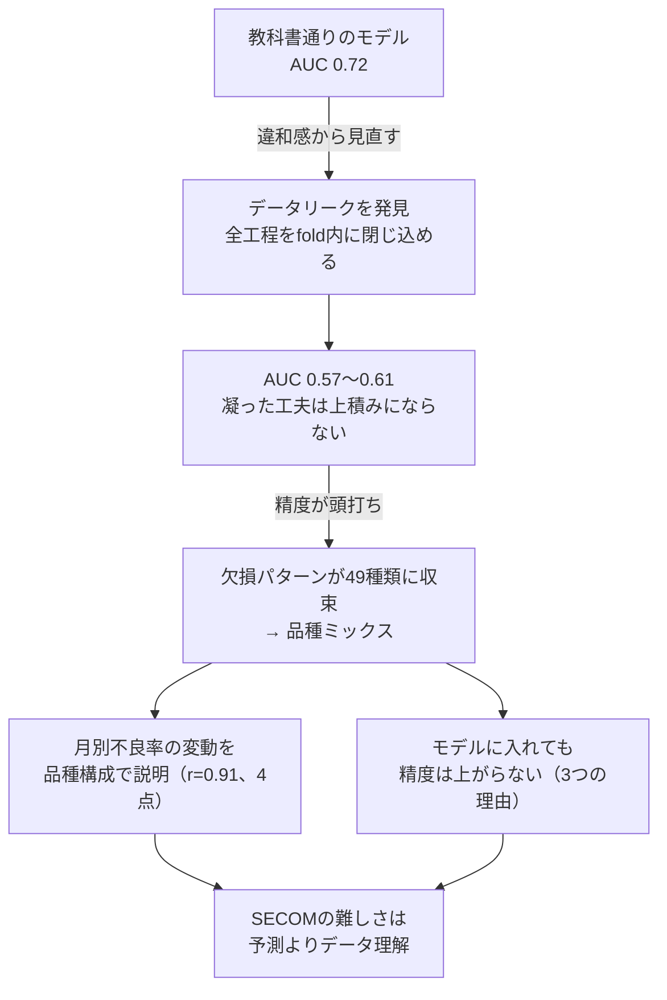
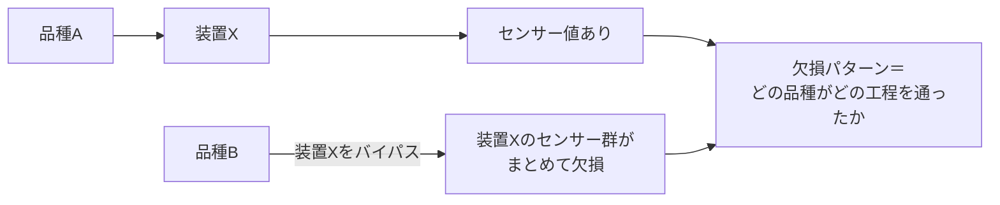

## この記事で分かること

製造業×データサイエンスの有名なデータセットSECOM(半導体製造工程のセンサーデータから不良を予測する)を、前職で電子部品メーカーの製造技術職として4年間、不良改善をしてきた感覚で読んだ。最初は「予測モデルを作って精度を上げる」つもりだったが、**AUC 0.72はほぼリークが生んだ幻で、厳密に測ると0.6前後が上限だった。代わりに、欠損パターンから「品種ミックス」という構造が見えた。**



考察が主軸なのでコードは少ない。API化・Docker化は実装編に分けた。分析のコードはすべて[GitHubのリポジトリ](https://github.com/yuya0408/secom-defect-prediction)にある。

### この記事が役に立つ人

| 読み手 | 役に立つ所 |
| --- | --- |
| 交差検証の評価にリークが紛れていないか確かめたい人 | リークが入った5か所と、全工程を各foldの訓練データ内に閉じ込める直し方(3〜4章) |
| 精度が頭打ちになったとき、データの構造から理由を探したい人 | 欠損パターンから品種ミックスを読み、月別不良率の変動を説明した過程(5〜6章) |
| 製造業のデータ分析に現場の経験をどう使うか知りたい人 | 経験が効いた所と、思い込みになりかけた所(6章・9章) |
| SECOMを予測の練習に使おうとしている人 | データの成り立ちと、精度が出にくい理由(1章・8章) |

### 用語

| 用語 | 意味 |
| --- | --- |
| AUC | ROC曲線の下の面積。0.5がランダム、1が完全 |
| PR-AUC | 適合率-再現率曲線の下の面積。不均衡データの実力を映す。ランダムなら不良率と同じ値 |
| データリーク | 本来テスト時に見えない情報を、学習や前処理の段階で使ってしまうこと |
| TimeSeriesSplit | 時系列の順序を保ち、必ず過去で学習して未来で検証する交差検証 |
| 欠損フラグ | 「その列が欠損しているか」を0/1の特徴量にしたもの |
| 品種ミックス | 1つのラインに複数の品種が入れ替わりで流れること |

---

## 1. SECOMは予測のためのデータではない

**SECOMは因果的特徴量選択(多数の特徴量から結果に本当に効く要因を見つける)のベンチマークで、高い予測精度が出にくいことは最初から織り込み済みだ。** 著者自身が論文で、プロセスデータと不良の因果関係は限定的だと述べている。

| 項目 | 内容 |
| --- | --- |
| 公開 | 2008年、McCannとJohnston |
| 特徴量 | 半導体製造工程の590個のセンサー測定値。センサーIDは匿名化され、何を測っているかは不明 |
| サンプル | 1,567件。合格1,463件・不良104件(不良率6.64%の強い不均衡) |

KaggleやGitHubでは予測の素材として扱われるが、本来の用途からはずれている。この前提を知って「構造的に難しい」と理解するのと、知らずに「精度が上がらない」と悩むのとでは、分析の納得感がまるで違う。

---

## 2. 最初の挑戦：教科書通りのモデルでAUC 0.72

最初はこの前提を十分に把握しないまま、予測モデルを組み立てた。主モデルはRandom Forest(RF)で、ほかと比べて選んだのではなく、特徴量590に対してサンプル1,567という高次元・少サンプルで過学習を抑えやすく、スケール・外れ値・多重共線性に頑健で、チューニングをほとんどせずに崩れにくい出発点として決め打ちした。

| # | 前処理 | 判断と理由 |
| --- | --- | --- |
| 1 | 定数列の削除 | 値が1種類で情報が無い |
| 2 | 準定数列の削除 | 1つの値が95%以上を占める |
| 3 | 高欠損列の削除 | 欠損率50%以上 |
| 4 | 欠損フラグの特徴量化 | 欠損率5〜50%の列は消さず、「欠損している事実」を残す |
| 5 | 欠損値の補完 | 各列の中央値 |
| 6 | 外れ値の確認(±5σ) | **削除しない**。不良は「いつもと違う何か」が起きたときに生まれる。センサー値が大きく振れた瞬間こそ見たい情報かもしれない |
| 7 | 多重共線性の確認(相関0.95以上) | **削除しない**。問題になるのは主に線形回帰の係数の解釈で、RFの予測性能はほとんど落ちない。匿名化されたセンサーでは、どちらを残すかの判断材料も無い |
| 8 | 標準化 | StandardScaler |

さらにタイムスタンプから時系列の特徴量(生産順序、直近の不良の発生数など)を加えた。「不良は時間的に固まって出るのではないか」という仮説で、前職で生産順序が不良の要因と特定されたプロジェクトが下敷きにある。ただし公式にはこの時刻は「検査時点」で、製造順と対応するかは明示されていない(前職でも対応していなかった)。便宜上「製造順」とみなしたが、この前提は8章で限界として扱う。

最後に重要度の上位50列に絞ると、**AUCは0.72まで跳ね上がった**。難しいと言われるSECOMでこの数字が出て、一旦は手応えを感じた。

---

## 3. 違和感から見つけたデータリーク

時系列の特徴量を入れたのに、不良が固まって出るパターンを捉えた効果が思ったほど表れない。そこでパイプラインを頭から疑い直し、リークを見つけた。

| リーク | 何が起きていたか |
| --- | --- |
| **特徴量選択(致命的)** | 全データで重要度を計算して上位50列を選んでから、交差検証で評価していた。テストデータの答えを薄く覗き見た状態で選んだ特徴量になる |
| 前処理 | 中央値や標準化のパラメータを全データで計算していた(軽度) |
| 閾値の最適化 | テストデータ上で行っていた |
| 評価指標 | AUCだけを見て、不均衡データの実力を映すPR-AUCを見ていなかった |
| 不良率の偏り | 訓練とテストで不良率が大きく違うことに対処していなかった |

直すのに本質的に要ったのは1点だけで、**前処理から特徴量選択まで学習に関わる全工程を、各foldの訓練データの内側だけで完結させる**ことだ。ハイパーパラメータ(特徴量数やRFの深さ)は固定しているので、二重ループは要らない。

分割も、ランダムなk-foldでは未来で学習して過去を予測する時間の逆行が起きるので、TimeSeriesSplitにした。


**AUCは0.72から0.57へ落ちた。0.72という数字は、ほぼリークが生み出した幻だった。** 落胆というより納得に近かった。

---

## 4. 凝った工夫は上積みにならなかった

前処理の丁寧さを2段階(簡易＝定数列の削除と中央値補完だけ、きちんと＝2章の8ステップ)に分け、5パターンをリーク版と厳密版(全工程をfold内に閉じ込めた時系列CV)で比べた。

| パターン | リーク版 | 厳密版 |
|------|------|------|
| A：簡易的な前処理のみ | 0.5109 | 0.5210 |
| B：簡易的な前処理＋時系列特徴量 | 0.5654 | 0.5757 |
| C：きちんとした前処理のみ | 0.5641 | 0.6074 |
| D：きちんとした前処理＋時系列特徴量 | 0.5704 | 0.5985 |
| E：きちんとした前処理＋時系列特徴量＋特徴量選択（上位50列） | 0.7180 | 0.5739 |

厳密版で平均AUCが最も高いのはCのシンプルな構成(0.6074 ± 0.044)で、時系列特徴量を足したDも、特徴量選択を加えたEも下がった。CのPR-AUCは0.1346で、ランダムのベースライン(不良率と同じ0.0664)の約2倍。意味のある水準だが、華々しくはない。**凝った手法が、手間に見合う上積みをくれるとは限らない。**

:::message
**2026-10追記**: 公開時はこの表の平均AUCの並びだけで「C（きちんとした前処理＋RF）が最良」と書いていたが、差の検定はしていなかった。同じ時系列CVの予測でCとの差をDeLong検定（foldごとに分散を出してまとめた）にかけ、Holm補正をかけると、どの構成もCと有意な差は無かった。表に載せていなかった特徴量選択の上位100列版（0.6108）も、平均ではCを上回るが差は無い。Random Forestをロジスティック回帰・HistGradientBoostingと比べても同様だった。このデータ量では、AUCで0.07〜0.1未満の差は見分けられない。結果は[リポジトリのREADME](https://github.com/yuya0408/secom-defect-prediction#評価と判定)にまとめた。
:::

---

## 5. 欠損パターンから見えた品種ミックス

精度が頭打ちになったとき、そもそもこのデータは同じ装置で同じ製品を作り続けた記録なのか、と考えた。1本のラインが3ヶ月ずっと単一品種を流すのは、製造業ではむしろ稀だ。



欠損率が10〜70%の44列の欠損パターンでサンプルをまとめた。ランダムに欠損しているなら、パターンは無数に散らばるはずだ。

| 結果 | 値 |
| --- | --- |
| ユニークな欠損パターン | わずか49種類 |
| 上位30グループのカバー率 | 全体の95.4% |
| グループ別の不良率 | 0%〜23% |
| グループのサンプル数 | 最大でも100件強、小さいものは13件程度 |


**欠損はランダムではなく、いくつかの決まった経路(品種)に分かれる。全体平均6.64%は、性質の違う品種を混ぜて平均しただけの見かけの数字だった可能性がある。** ただしグループごとのN数は小さく、7章でモデルに組み込もうとしたときの壁になる。

前職は電子部品(金属製品)の製造で、半導体ウエハ製造の実務経験は無い。これは製造業全般に共通する現場感覚からの推測だが、データに現れた構造と経験はきれいに整合している。

---

## 6. 月別不良率の正体


7月の不良率は22%超(全体平均の3倍以上)で、9月には3%を切る。最初は暗黙に「7月はライン立ち上げ期」と解釈していたが、データのどこにもそうは書かれていない。

| 候補 | 根拠 | 判定 |
| --- | --- | --- |
| ライン立ち上げ期 | 立ち上げ直後は条件が安定しない(現場でよくある話) | データのどこにも書かれていない。経験に引きずられた思い込みかもしれない |
| 工程の変更 | 変化点があれば不良は動く | 品種構成ほど整合的な説明にはならなかった |
| **扱う品種の構成** | 5章の品種ミックス | 月ごとの「高不良グループの割合」と月別不良率が強く相関した |


```
Pearson相関 r = 0.91、p = 0.09（7〜10月の4点）
```

4点しかないので統計的には断定できず、品種ミックス仮説と強く整合する示唆にとどまる。それでも、7月の高不良率は立ち上げの苦労でも装置の問題でもなく、単に不良が出やすい品種が多く流れていただけかもしれない。経験は補助線にもなれば、思い込みの罠にもなる。

---

## 7. 品種情報はモデルに使えなかった

品種で不良率がこれだけ違うなら、モデルに与えれば精度が上がるのではないか。一方で、グループあたりのサンプル数が足りない懸念もあった。両方を確かめた。


**どのアプローチもベースラインを超えられなかった。**

| 理由 | 内容 |
| --- | --- |
| 1. サンプル数が足りない | グループあたりの不良はせいぜい10件程度で、グループ別にモデルを学習する統計的な根拠が成り立たない(下の表) |
| 2. 新しい品種が次々入る(ドリフト) | あるfoldでは、テストデータの35%が訓練データに無い新しいグループだった |
| 3. 既存の特徴量に品種情報が既にあった | 通常の前処理で作る欠損フラグ24列が、主要な品種グループの大枠をすでに区別していた。グループIDを足しても新しい情報がほとんど無い |

「グループ別モデル(N=K)」は、K件以上の学習データがあるグループだけ専用モデルを学習し、残りは全体モデルに任せる手法だ(最大グループでも155件)。

| 手法 | AUC | ばらつき(5分割の標準偏差) |
| --- | --- | --- |
| ベースライン | 0.607 | ±0.04 |
| グループ別 N=100(最大級のグループだけ個別化) | 0.608 | ±0.04 |
| グループ別 N=50 | 0.542 | ±0.13 |
| グループ別 N=30 | 0.525 | ±0.13 |


**品種ミックスはデータを理解する上では決定的に重要だったが、予測精度の向上には直接つながらなかった。** 発見が必ず性能改善に結びつくわけではない。

---

## 8. SECOMの本質的な難しさ

厳密に評価すれば、このデータでの予測性能はAUC 0.60前後が現実的な上限に見える。原因はモデリングの技術ではなく、データの構造にある。

| 原因 | 内容 |
| --- | --- |
| 品種情報が無い | 不良率は品種グループで0%〜23%と違うのに、品種を示す列が無い。欠損パターンから推測で復元しても、統計的な裏付けは得られなかった |
| センサーが匿名 | 値の意味を踏まえた解釈ができない。相関に意味を見出しても「それが何を表すか」まで踏み込めない |
| 予測のためのデータではない | 因果的特徴量選択のベンチマークで、因果関係は限定的と著者が述べている(1章) |
| タイムスタンプが検査時刻 | 「生産順序」「月別不良率」は、厳密には「検査順」「検査月」かもしれない(秒の桁がすべて00で実質分単位という粗さもある) |

タイムスタンプの曖昧さは結論に影響しない。厳密評価では時系列特徴量は精度に寄与せず、品種ミックスは欠損パターンから導いたものでタイムスタンプとは独立だからだ。**SECOMが物語るのは「予測の難しさ」というより「データ理解の難しさ」で、高い精度が出ないこと自体がこのデータの誠実な姿だ。**

---

## 9. 現場感覚が効いた所と、その限界

| | 内容 |
| --- | --- |
| 効いた所 | 欠損パターンの49種類への収束を「品種ごとに工程をバイパスしている」という仮説に結びつけた。外れ値を削除しない判断、月別不良率を品種で読み解いた過程も、根は同じ「不良はいつもと違う何かに宿り、変化点があれば動く」という感覚 |
| 限界を見抜いた所 | タイムスタンプを「製造順」として扱っていたが、前職で製造順と検査順が対応していなかったことを思い出して前提を疑えた |
| 経験の限界 | 前職は電子部品製造で、半導体ウエハ製造の専門家ではない。本記事の解釈は推測であって断定ではない |

**最大の学びは「データを使う前に、まず読む」ことだった。** スコアは幻で、価値があったのは、リークを疑い、データの構造を確かめ、品種ミックスを読み解く過程の方だった。

分析は読んで終わりではない。精度に限界があるモデルでも、動かせる形にして初めて現場で使えるかの土俵に乗る。実装編では、**モデルを学習させ、APIとして提供し、コンテナ化して再現可能にするまでの流れ**を扱う。

---

このプロジェクトは、同じ1つの題材を3つの角度から書いた3部作になっている。あわせてどうぞ。

- **実装編**（[記事](https://zenn.dev/yuya0408/articles/secom-defect-serving)）― 分析結果を API・コンテナとして動かせる形にする話
- **運用編**（[記事](https://zenn.dev/yuya0408/articles/secom-defect-operations)）― 動かし続けるために何を監視し、異常を見つけたらどう動くかの話
<!-- gbrain: [Source: User, 記事執筆・公開, 2026-09-13] -->
