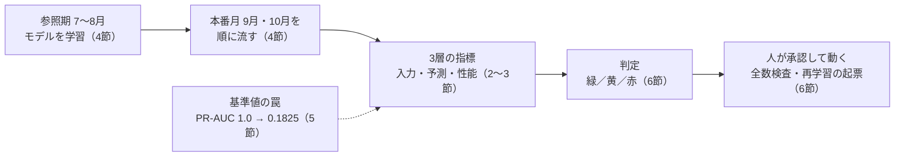
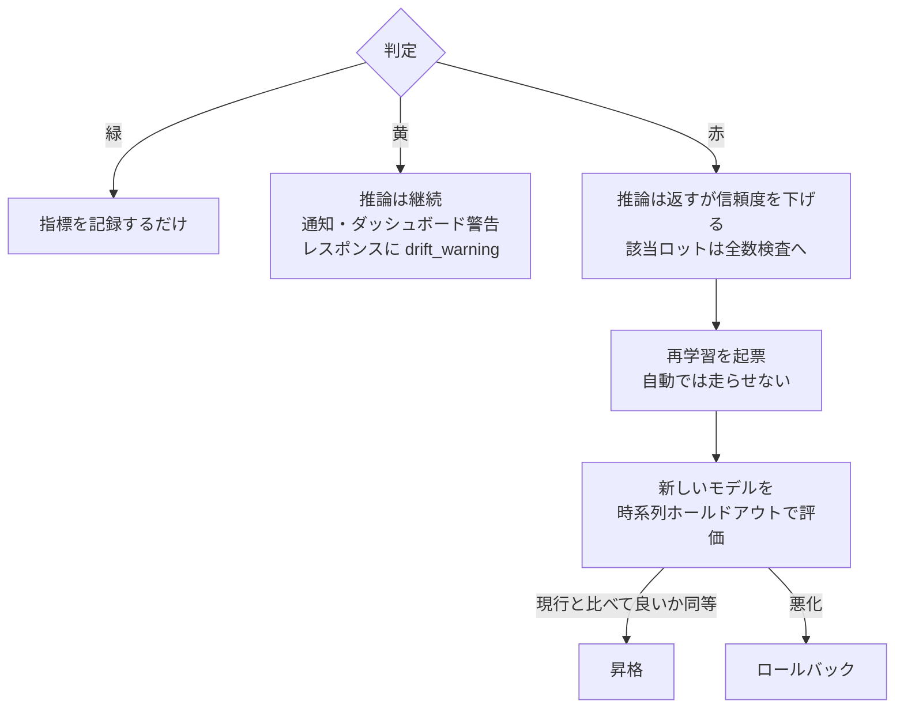

## この記事で分かること

実装編で推論APIにしたSECOMの不良予測モデル(AUC 0.6前後)を、置き続けるために何を見張り、異常を見つけたらどう動くかを決めた。**考察編の「品種ミックス」をそのまま監視指標にし、凍結データを月ごとに流すと、学習時に無かった品種グループの割合が9月9.2%→10月35.9%と増え、ドリフトを運用の指標として捉えられた。** 途中で、基準のPR-AUCが1.0になる罠(学習に使ったデータを採点していた)にも当たった。



扱うのは凍結データ上の実演で、本番の監視基盤は作っていない(7節)。監視指標の作り方は2〜4節、評価の落とし穴だけなら5節、検知後の動き方は6節を読めばよい。コードはすべて[GitHubのリポジトリ](https://github.com/yuya0408/secom-defect-prediction)にある。

:::message
あくまで運用のベストプラクティス集ではない。
:::

### この記事が役に立つ人

| 読み手 | 役に立つ所 |
| --- | --- |
| 精度の高くないモデルを現場に置き続けるとき、何を見張るか決めたい人 | ラベルの要否で分けた3層の監視と、その構え方(2節) |
| 分析で見つけたデータの構造を、ドリフトの監視指標にしたい人 | 欠損パターンから作る未知グループ率(3節) |
| 本番のデータが無いところで、監視の仕組みを動かして確かめたい人 | 凍結データを月ごとに流すリプレイ(4節) |
| 監視の基準値が妙に良い、またはPSIが大きすぎる人 | 学習に使ったデータを採点していた原因と、out-of-fold予測での直し方(5節) |
| ドリフトを検知したあとの動き方と、再学習の線引きを決めたい人 | 緑/黄/赤ごとの動き方と、自動で再学習しない理由(6節) |

### 用語

| 用語 | 意味 |
| --- | --- |
| データドリフト | 学習したときのデータと、いま流れてくるデータの分布が時間とともにズレること |
| 品種ミックス | 1つのラインに複数の品種が入れ替わりで流れること。考察編で欠損パターンから見つけた |
| 未知グループ率 | 新しいデータのうち、学習(参照)期に存在しなかった欠損パターンのグループに属する割合 |
| PSI | Population Stability Index。学習時のスコア分布を分位点でビンに切り、新データの各ビンの比率と比べる指標 |
| PR-AUC | 適合率-再現率曲線の下の面積。不均衡データの実力を映す |
| out-of-fold予測 | 交差検証で、各サンプルを「それを学習に使っていないモデル」で採点した予測 |
| リプレイ | 凍結データを時刻順に区切り、本番で流れてくるかのように順にモデルへ流す方法 |

---

## 1. なぜ運用編が必要だったか

**時系列で評価すると、テスト期に学習時には存在しなかった品種グループが次々と現れる。** 考察編では、あるfoldでテストデータの35%が新グループだった。分析の上では「品種情報をモデルに組み込めなかった理由」のひとつだったが、運用の視点で読み直すと、学習したときの世界と、いま流れてくる製品の世界が時間とともにズレていく、データドリフトそのものだ。

推論APIにしたこのモデルをそのまま置き続ければ、いつか「知らない世界」を相手に予測することになる。精度が0.6で余裕がないのに土台の前提が崩れたら、予測は意味を失う。だから運用編のテーマは、**モデルが知らない世界を相手にしていないかを、どう見張るか**になる。

---

## 2. 何を監視するのか：3層に分けて考える

**製造現場では検査結果(真のラベル)が遅れて確定するので、ラベルの要否で監視を3層に分けた。**

| 層 | 見るもの | ラベルの要否 |
| --- | --- | --- |
| 入力ドリフト | 入ってくるデータの分布が学習時とズレていないか | 不要（即時に分かる） |
| 予測ドリフト | モデルが出す不良確率の分布が変わっていないか | 不要（即時に分かる） |
| 性能ドリフト | 実際の検査結果に対して、予測が当たっているか | **必要（検査結果が出てから）** |

入力・予測ドリフトで即時に異常の気配を察知し、検査結果が溜まったら性能で裏を取る、という二段構えになる。

---

## 3. 品種ミックスを、そのまま監視指標に転用する

**入力ドリフトには、考察編の品種ミックスをそのまま使った。** 欠損率10〜70%の列の欠損パターンで品種グループを定義し(欠損のしかたが、どの工程を通ったか、バイパスしたかの手がかりになる)、学習(参照)期に現れたグループの集合を覚えておく。新しいデータでは、そこに無いグループの割合を計算する。

```python
# src/monitoring.py より（要点）
def missing_pattern_signature(df, flag_cols):
    """欠損パターンからサンプルごとのグループ署名（"010..." 形式）を作る。"""
    miss = df[flag_cols].isna().astype(int)
    return miss.apply(lambda row: "".join(map(str, row.values)), axis=1)

def unknown_group_rate(reference_signatures, new_signatures):
    """学習時に存在しなかったグループ署名を持つ新データの割合。"""
    known = set(reference_signatures)
    return sum(1 for s in new_signatures if s not in known) / len(new_signatures)
```

| 層 | 指標 | 目安 |
| --- | --- | --- |
| 入力ドリフト | 未知グループ率 | — |
| 予測ドリフト | 予測のPSI | 0.1未満なら安定、0.1〜0.25は要注意、0.25超は大きな変化(慣用的な目安) |
| 性能ドリフト | PR-AUC | 参照期の基準(0.18、5節) |

監視は外部のツールを使わず、素のnumpy/pandasで書いた。中身がブラックボックスにならず、何を計算しているかを自分で説明できる状態にしておくためだ。

---

## 4. 「動かして見せる」：時系列リプレイ

**SECOMは2008年で完結した凍結データで本番ラインが無いので、検査の時刻で月ごとに分けて順にモデルへ流し、ドリフトを再現した。**

| 条件 | 内容 |
| --- | --- |
| データの期間 | 2008年7月〜10月の4か月 |
| 参照(学習)期 | 7〜8月。ここでモデルを学習する |
| 本番月 | 9月・10月を順に流す |
| 検査結果(ラベル) | 全期間揃っている。本番では遅れて確定する性能ドリフトを、ここでは即座に測れる(デモのための割り切り) |

```bash
python -m scripts.replay_drift
# => reports/drift_report.md と図を生成
```


| 月 | 未知グループ率 | 予測PSI | PR-AUC | 判定 |
| --- | --- | --- | --- | --- |
| 2008-09 | 9.2% | 0.279 | 0.202 | RED |
| 2008-10 | **35.9%** | 0.397 | 0.141 | RED |

**未知グループ率が9.2%→35.9%と月を追って増えた。** 1節の「テスト期に新グループが現れる」現象が、運用の指標として動いた。10月にはPR-AUCも参照期の基準(0.18)を下回り、性能の劣化まで観測できた。

両月とも赤で、緑や黄の段階を経ずにいきなり危険水準に入っている。9月の時点で、モデルが学習した7〜8月の世界とはもうかなりズレていたということだ。このデータは9月に不良率が3%を切るほど大きく変動しており、その符合とも読める。

---

## 5. レビューで拾った罠：基準値が「満点」になっていた

**基準のPR-AUCが1.0000、予測PSIが3.8〜4.0という値が出た。原因は、学習に使ったのと同じデータをそのまま採点していたことだった。**

```python
model.fit(X_ref, y_ref)                       # 参照データで学習
ref_scores = model.predict_proba(X_ref)[:, 1] # ← 同じ参照データを採点
baseline_pr_auc = average_precision_score(y_ref, ref_scores)
```

Random Forestは学習データをほぼ暗記するので、訓練行への予測は不良≈1.0・合格≈0.0にきれいに張り付く。

| 指標 | おかしな値 | なぜそうなったか | 影響 |
| --- | --- | --- | --- |
| 基準のPR-AUC | 1.0000 | 暗記したデータ上では完璧に分類できる | その後の全月が「基準割れ」になり、性能の判定が無意味になる |
| 予測PSI | 3.8〜4.0 | 0と1に張り付いた暗記スコアと、0.1前後に穏やかに広がる本番月のスコアを比べていた | 過学習が生んだ見せかけの違いで、実際のドリフトではない |

参照期は618件・陽性65件で、1回のホールドアウトでは検証側の陽性が十数件しか残らず、基準値がどの陽性が検証側に入ったかで決まってしまう。そこで分割を5回ローテーションして全件を一度ずつ検証に回す、out-of-fold予測を使った。

```python
ref_scores = cross_val_predict(
    make_model(), X_ref, y_ref,
    cv=StratifiedKFold(5, shuffle=True, random_state=42),
    method="predict_proba",
)[:, 1]
baseline_pr_auc = average_precision_score(y_ref, ref_scores)
```

```text
基準のPR-AUC: 1.0000（学習データを採点）→ 0.1825（out-of-fold予測）
考察編の厳密評価: 0.1346（どちらもランダム水準の約2倍で、桁が合う）
```

基準が現実的になり、PSIも意味のある値に戻った。**「1.0はおかしい」と立ち止まれるかが分かれ目だ。** 考察編で特徴量選択を交差検証の外でやっていたリークと根は同じで、評価の独立性を一箇所でも崩すと、数字は簡単に嘘をつく。

---

## 6. 検知したら、どう動くか

**深刻度を緑/黄/赤の3段階で判定し、段階ごとに動きを変える。判定はコードで行うが、実際のアクションは人間が承認する前提にした。**

```python
# src/monitoring.py より
RECOMMENDED_ACTIONS = {
    "green":  "通常運用。指標を記録するのみ。",
    "yellow": "推論は継続しつつ通知・ダッシュボード警告。レスポンスに drift_warning を付与。",
    "red":    "推論は返すが信頼度を下げ、該当ロットを全数検査へ。再学習を起票（自動実行しない）。",
}
```



| 方針 | 理由 |
| --- | --- |
| 赤でもAPIを止めない | 製造ラインの検査補助は、止まると現場が困る。フェイルセーフは「止める」ではなく「人の目を増やす」側に倒した |
| 自動で再学習・デプロイしない | 赤では再学習を起票するだけで、昇格は評価を経てから |
| 再学習は目的ではなく手段 | 考察編では品種情報を足しても精度は上がらず、このデータでは再学習しても精度が上がるとは限らない。監視の主目的は、入力が学習時から乖離してモデルが無意味化していないかの検知と、しきい値の再調整・再学習を起票するかの判断に置く |

最後の方針は、製造現場上がりとして一番こだわった点だ。

---

## 7. これは「実演」であって「本番監視」ではない

**本記事でやったのは、凍結データの上でドリフト監視の仕組みを動かして見せたことだ。**

| | 本記事(実演) | 本番の製造ライン監視 |
| --- | --- | --- |
| 検査結果(ラベル) | 全期間揃っていて、性能ドリフトを即座に測れる | 遅れて確定する |
| 基盤 | 判定ロジックと実演まで。アラート・ダッシュボード・再学習パイプラインは作っていない(設計の思想をコードと文章で示すに留めた) | 常時稼働の基盤が要る |
| 流れるデータ | SECOMの凍結データ。Hugging Face Spacesなどでデモ公開しても、流れるのはデモ利用者のトラフィック | 製造ラインの実分布 |

それでも、監視の仕組みが確かに動き、考察編で見つけたドリフトを運用の指標として捉えられることは示せた。

---

## まとめ

| 確かめること | 確かめ方 |
| --- | --- |
| 入力が、学習した時の世界から外れていないか | 欠損パターンの未知グループ率を月ごとに見る(3〜4節) |
| モデルが出す確率の分布が変わっていないか | 学習時のスコア分布とのPSIを見る。0.1/0.25が目安(3節) |
| 予測が当たっているか | 検査結果が溜まったら、PR-AUCを参照期の基準と比べる(2・4節) |
| 基準値そのものがおかしくないか | 1.0のような値が出たら、学習に使ったデータを採点していないか疑い、out-of-fold予測で出し直す(5節) |
| 赤のとき現場を止めずに済むか | 推論は返し、drift_warningを付けて該当ロットを全数検査へ回す(6節) |
| 新しいモデルを昇格させてよいか | 時系列ホールドアウトで現行と比べ、良いか同等のときだけ昇格させる(6節) |

**ノートブックでスコアを出すことと、モデルを現場に置き続けることの間には、いくつもの壁がある。** 3本で、考察編は「データを読む」壁を、実装編は「動かせる形にする」壁を、運用編は「動かし続ける」壁を手で確かめた。精度0.6のモデルはそれ単体では頼りないが、何を見張るかを決め、異常を見つけたときの動き方を用意しておけば、現場に置き続けることはできる。製造業にいた頃に学んだ「変化点を見張る」という感覚は、モデルの運用にもそのまま効いた。

---

このプロジェクトは、同じ1つの題材を3つの角度から書いた3部作になっている。あわせてどうぞ。

- **考察編**（[記事](https://zenn.dev/yuya0408/articles/secom-defect-analysis)）― このデータが何を物語っているかを読み解く話
- **実装編**（[記事](https://zenn.dev/yuya0408/articles/secom-defect-serving)）― 分析結果を API・コンテナとして動かせる形にする話
<!-- gbrain: [Source: User, 記事執筆・公開, 2026-09-13] -->
