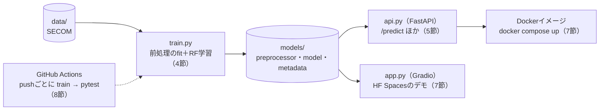
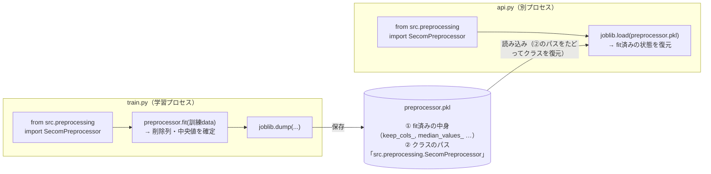

## この記事で分かること

考察編でAUC 0.60前後が上限と分かったSECOMの不良予測モデルを、推論APIとDockerイメージにして、誰が実行しても同じ結果が出る状態にした。**山場は派手な技術ではなく、ノートブックで定義した前処理クラスを独立モジュールに切り出し、学習側とAPI側で同じimportパスを使うという一手だった。** 精度に限界のあるモデルでも、動かせる形にして初めて現場で使えるかの土俵に乗る。



クラウドへの実デプロイは扱わない(7節)。pickleで自作クラスが読めない問題だけなら2〜3節、APIの設計は4〜6節、再現性(Docker・CI・版の固定)は7〜9節を読めばよい。コードはすべて[GitHubのリポジトリ](https://github.com/yuya0408/secom-defect-prediction)にある。

:::message
あくまでベストプラクティスの教科書ではない。
:::

### 前提: 考察編の結論

本記事は単独でも追えるが、ここで扱うモデルの精度に限界がある理由は[考察編](https://zenn.dev/yuya0408/articles/secom-defect-analysis)にある。

| 項目 | 内容 |
| --- | --- |
| SECOM | 半導体製造工程の590個のセンサー値から不良を予測するデータセット。1,567件、不良率6.64%の強い不均衡、センサーは匿名化。もとは「因果的特徴量選択」のベンチマークで、**高い精度が出にくいのは設計上の前提** |
| 精度の現実 | 当初のAUC 0.72は、特徴量選択やしきい値最適化を交差検証の外でやったデータリークだった。全工程を各foldの訓練データ内に閉じ込めて時系列で分割すると、AUC 0.60前後(PR-AUC 0.1346、ランダムの約2倍)が上限。「きちんとした前処理＋Random Forest」に、凝った前処理や時系列特徴量は上積みにならなかった |
| 品種ミックス | 欠損パターンでサンプルを分けると、不良率が0%〜23%のグループに分かれた。ただしサンプル数の不足・未知の品種の出現(ドリフト)・欠損フラグに既に含まれていた、の3点で精度向上にはつながらなかった |
| 結論 | SECOMの難しさはモデリングではなくデータ理解にある |

### この記事が役に立つ人

| 読み手 | 役に立つ所 |
| --- | --- |
| ノートブックで作ったモデルを、初めてAPIやコンテナにする人 | 保存からAPI・Docker・CIまでの一通りの流れ(1〜9節) |
| 自作の前処理クラスをpickleで保存し、別プロセスで読めずに困っている人 | 失敗する理由と、importパスを揃える直し方(2〜3節) |
| 予測1件ごとに、どの版のモデルが出したかを辿れるようにしたい人 | メタデータに版を持たせ、レスポンスに刻む形(4節) |
| ローカルでは通るのにCIで落ちるテストがある人 | テスト専用の依存を分ける方法(8節) |

### 用語

| 用語 | 意味 |
| --- | --- |
| joblib / pickle | Pythonのオブジェクトをファイルに保存・復元する仕組み。joblibの中身はpickle |
| fit / transform | scikit-learnの作法。`fit`で訓練データから変換のルールを決め、`transform`でそのルールを適用する |
| Pydantic | 型を定義するだけで入力のバリデーションができるライブラリ。FastAPIが入出力の定義に使う |
| Swagger UI | FastAPIが自動生成するAPIドキュメント。ブラウザから各エンドポイントを試せる |
| TestClient | サーバーを別途起動せず、テストプロセスの中からFastAPIのAPIを呼べる仕組み |
| レイヤーキャッシュ | Dockerが命令ごとに結果をキャッシュし、変更があった命令から下だけを作り直す仕組み |

---

## 1. 作るもの

**センサー値を投げると「不良である確率」が返る推論APIを作り、`docker compose up`の一発で誰でも同じものを立ち上げられるようにする。**

```bash
curl -X POST http://localhost:8000/predict \
  -H "Content-Type: application/json" \
  -d @sample_input.json
```

```json
{"defect_probability": 0.6597, "is_defect": true, "threshold": 0.5}
```

考察編のノートブック・図表と実装編のコードは、同じプロジェクトなので1つのリポジトリにまとめた。

```text
secom-defect-prediction/
├── README.md
├── requirements.txt          # 再現のための固定バージョン
├── Dockerfile
├── docker-compose.yml
├── sample_input.json         # 動作確認用サンプル（実データの不良行1件）
├── src/
│   ├── preprocessing.py      # 前処理クラス（リーク防止 / 独立モジュール）
│   ├── train.py              # 最終モデルの学習と保存
│   └── api.py                # FastAPI 推論サーバー
├── models/                   # 学習済み preprocessor / model / metadata
├── data/                     # secom.data, secom_labels.data, secom.names（UCI 公式）
├── notebooks/                # 考察編の分析ノートブック
├── reports/figures/          # 考察編の図表
├── tests/test_api.py         # pytest
└── .github/workflows/ci.yml  # 学習 → テストの CI
```

---

## 2. 学習済みモデルの「持ち運び」

**ノートブックの中で定義したクラスを使って保存したモデルは、別プロセスのAPIからそのままでは読み込めない。** ノートブックから運用へ出るときに最初にぶつかり、理解に一番時間をかけたのがここだった。

考察編の前処理は、学習時の統計量だけで変換する自作クラス`SecomPreprocessor`にまとめてあった。これをノートブックで学習させて保存する。

```python
import joblib
joblib.dump(preprocessor, "models/preprocessor.pkl")
joblib.dump(model, "models/model.pkl")
```

ノートブックの中では読み戻せるが、API(別のPythonプロセス)から読むとこうなる。

```text
AttributeError: Can't get attribute 'SecomPreprocessor' on <module '__main__'>
```

pickleが保存するのは**クラスの中身ではなく「そのクラスがどのモジュールに定義されているか」というパスだけ**だ。ノートブックで定義したクラスは`__main__.SecomPreprocessor`として記録され、APIプロセスの`__main__`にはそれが無いので復元に失敗する。自作クラスをpickle化するときに普遍的にハマる点だと思う。

解決策は、**クラスを独立した`.py`モジュールに切り出し、学習側もAPI側も同じパスからimportする**ことだ。

```python
# 学習側・API側、どちらも同じこの一行で参照する
from src.preprocessing import SecomPreprocessor
```

pickleに記録されるパスは`src.preprocessing.SecomPreprocessor`で一貫し、`src.preprocessing`をimportできるプロセスならどこからでも復元できる。



注: pklには①fit済みの中身と②クラスのパスの両方が入っている。両プロセスが同じimportパスを共有するので、②をたどって復元できる。

---

## 3. 前処理をクラスとして切り出す

**削除する列も補完の中央値も、すべて`fit`の中で訓練データから決め、`transform`ではそれを適用するだけにした。** 考察編の8ステップの前処理を`src/preprocessing.py`に整理したもので、要点はこうなる。

```python
from sklearn.base import BaseEstimator, TransformerMixin

class SecomPreprocessor(BaseEstimator, TransformerMixin):
    def fit(self, X, y=None):
        df = pd.DataFrame(X)
        df.columns = [str(c) for c in df.columns]

        # 1. 定数列、2. 準定数列、3. 高欠損列 を「訓練データから」検出
        self.constant_cols_ = df.columns[df.nunique() <= 1].tolist()
        # （準定数・高欠損列の検出は省略）

        # 5. 補完用の中央値も「訓練データから」算出して保持
        self.median_values_ = df[self.keep_cols_].median()
        return self

    def transform(self, X):
        df = pd.DataFrame(X)
        df.columns = [str(c) for c in df.columns]
        kept = df[self.keep_cols_].copy()
        # 4. 欠損フラグ化 → 5. 学習時の中央値で補完
        flags = kept[self.flag_cols_].isna().astype(int)
        kept = kept.fillna(self.median_values_)
        return pd.concat([kept, flags], axis=1).values
```

| | 学習(train.py) | API(api.py) |
| --- | --- | --- |
| 呼ぶメソッド | `fit_transform` | `transform`だけ |
| 削除列・中央値 | 訓練データから決める | 学習時に確定した状態を読み込む(2節) |
| `fit`し直すと | — | 本番の1件で削除列も中央値も別物になり、未来のデータを使うリークになる |

考察編で痛い目を見たデータリークを構造として防ぎ、評価時と本番で挙動がずれない。`BaseEstimator`/`TransformerMixin`を継承したのは、scikit-learnの`Pipeline`に組み込めるようにし、`get_params`などの作法を自動で満たすためだ。

---

## 4. 最終モデルを学習して保存する

**`src/train.py`は、考察編の結論「きちんとした前処理＋Random Forest」を全データで学習し直し、前処理・モデル・メタデータの3つを保存する。**

```python
from src.preprocessing import SecomPreprocessor  # ← 同じパスから import
from sklearn.ensemble import RandomForestClassifier
import joblib

def main():
    df, y = load_data()  # secom.data / secom_labels.data を読む

    preprocessor = SecomPreprocessor()
    X = preprocessor.fit_transform(df)

    model = RandomForestClassifier(
        n_estimators=200, max_depth=10, class_weight="balanced",
        random_state=42, n_jobs=-1,
    )
    model.fit(X, y)

    # 前処理・モデル・メタデータの3点を保存
    joblib.dump(preprocessor, "models/preprocessor.pkl")
    joblib.dump(model, "models/model.pkl")
    joblib.dump(metadata, "models/metadata.pkl")
```

```text
$ python -m src.train
データ読み込み: (1567, 590)  不良率 6.64%
前処理サマリー: {'constant_removed': 116, 'quasi_constant_removed': 10,
               'high_missing_removed': 28, 'kept_columns': 436,
               'missing_flags_added': 24}
入力特徴量数: 590  ->  前処理後: 460
```

```text
前処理後の特徴量 = 残った列 436 + 欠損フラグ 24 = 460
```

この「入力は590、モデルが食うのは460」という変換を前処理クラスが吸収するので、APIの利用者は生の590個を渡すだけでよい。

| ファイル | 中身 | 使い道 |
| --- | --- | --- |
| `preprocessor.pkl` | fit済みの`SecomPreprocessor` | APIで`transform`する(3節) |
| `model.pkl` | 学習済みのRandom Forest | 確率を出す |
| `metadata.pkl` | モデルの種類、入力特徴量数、学習サンプル数、厳密評価で得た真のAUC(0.6074)、版(`version`)、学習日時(`trained_at`)など | `/metadata`で返す。版はレスポンスにも刻む |

**精度に限界があるモデルほど、その限界値を成果物自身に持たせておく意味は大きい。** 版は推論のレスポンスにも`model_version`として入れた。

```json
{"defect_probability": 0.6597, "is_defect": true, "threshold": 0.5, "model_version": "1.0.0"}
```

この不良確率をいつ学習したどの版が出したのかを予測1件ごとにログから辿れるので、新旧モデルの比較も、問題が起きたときのロールバックもできる。

---

## 5. FastAPIで推論APIを作る

**FastAPIを選んだのは、型を定義するだけで入力バリデーションとSwagger UIが自動生成され、少ないコードで「試せる」状態になるからだ。** 起動時にモデルを読み込む。ここで`src.preprocessing`をimportしておくのが、2節で見た復元の鍵になる。

```python
import joblib
from fastapi import FastAPI
# この import があることで joblib.load が SecomPreprocessor を復元できる
from src.preprocessing import SecomPreprocessor  # noqa: F401

preprocessor = joblib.load("models/preprocessor.pkl")
model = joblib.load("models/model.pkl")
metadata = joblib.load("models/metadata.pkl")

app = FastAPI(title="SECOM 不良予測 API")
```

入力は590個ちょうどでなければ弾く。欠損しているセンサーは`null`で受け取り、補完は学習済みの中央値に任せる。

```python
from pydantic import BaseModel, Field, field_validator
from typing import List, Optional

N_FEATURES = metadata["input_features"]  # 590

class PredictRequest(BaseModel):
    features: List[Optional[float]] = Field(..., description="590個のセンサー値（欠損はnull可）")
    threshold: Optional[float] = Field(None, ge=0.0, le=1.0)

    @field_validator("features")
    @classmethod
    def _check_length(cls, v):
        if len(v) != N_FEATURES:
            raise ValueError(f"features は {N_FEATURES} 要素である必要があります（受信: {len(v)}）")
        return v
```

```python
@app.post("/predict")
def predict(req: PredictRequest):
    threshold = req.threshold if req.threshold is not None else 0.5
    raw = pd.DataFrame([req.features])     # 列名 0..589 のDataFrame
    X = preprocessor.transform(raw)        # 590 -> 460 に変換
    proba = float(model.predict_proba(X)[:, 1][0])
    return {
        "defect_probability": proba,
        "is_defect": proba >= threshold,
        "threshold": threshold,
    }
```

| エンドポイント | 役割 |
| --- | --- |
| `/` | 概要 |
| `/health` | ヘルスチェック |
| `/metadata` | モデル情報(4節) |
| `/predict` | 1件の推論 |
| `/predict/batch` | 複数件の推論 |

`uvicorn src.api:app --reload`で起動して`http://localhost:8000/docs`を開くと、Swagger UIからブラウザだけで全エンドポイントを試せる。

### しきい値を引数にした理由

**しきい値はモデルに焼き付けず、リクエストごとに指定できるようにした(省略時は0.5)。** 不均衡データなので、0.5を境にするとほぼ全部が「合格」に倒れる。最適なしきい値は「不良を見逃すコスト」と「過検出のコスト」のバランス次第で、どこで線を引くかは技術ではなくビジネス側の判断だ、という考察編の結論をAPIの設計に反映した。

```bash
# 同じ入力でも、しきい値を下げれば拾いやすくなる
curl ... -d '{"features": [...], "threshold": 0.3}'
```

:::message
**2026-10追記**: 省略時の0.5は、未知のデータを1件も不良と判定しない値だった。学習に使っていない期間に対する予測（時系列CVのout-of-fold予測）では、確率は最大でも0.36にとどまる。現在の既定値は、「不良確率の上位50%を検査に回す」という規則から学習のたびに計算する値（0.0612）で、規則と前提はモデルのメタデータに記録している。詳しくは[リポジトリのREADME](https://github.com/yuya0408/secom-defect-prediction#評価と判定)にまとめた。
:::

---

## 6. 590個の入力をどう用意するか

**590個のセンサー値を手で書くのは非現実的なので、テストデータの実際の1行から入力JSONを作るスクリプトを用意した。** デモとして分かりやすいよう、実際に不良だった行を選ぶ。

```python
# scripts/make_sample_input.py の要点
row = df.iloc[fail_idx].tolist()
# NaN は JSON の null に変換（API の欠損補完を試すことにもなる）
features = [None if math.isnan(v) else float(v) for v in row]
json.dump({"features": features}, open("sample_input.json", "w"))
```

| 入力 | レスポンス |
| --- | --- |
| 不良行(`sample_input.json`) | `{"defect_probability": 0.6597, "is_defect": true,  "threshold": 0.5}` |
| 合格行 | `{"defect_probability": 0.0870, "is_defect": false, "threshold": 0.5}` |

ただし、どちらの行も学習データに含まれるので、この差はモデルの実力を示すものではない（2026-10追記。未知のデータに対する確率は最大でも0.36程度）。このサンプルがあるので、READMEに`curl`一行で動く例を載せられ、リポジトリを開いた人がすぐ試せる。

---

## 7. Dockerで再現可能にする

**「私の環境では動く」では運用に乗らないので、Dockerで環境ごと持ち運べるようにした。**

```dockerfile
FROM python:3.12-slim

ENV PYTHONUNBUFFERED=1 PYTHONDONTWRITEBYTECODE=1
WORKDIR /app

# 依存だけ先に入れてレイヤーキャッシュを効かせる
COPY requirements.txt .
RUN pip install --no-cache-dir -r requirements.txt

# アプリ本体と学習済みモデルをコピー
COPY src/ ./src/
COPY models/ ./models/

EXPOSE 8000
CMD ["uvicorn", "src.api:app", "--host", "0.0.0.0", "--port", "8000"]
```

| 工夫 | 効果 |
| --- | --- |
| `requirements.txt`のコピーと`pip install`を、コードのコピーより前に置く | コードだけ直したビルドでは依存のインストールがキャッシュされ、再実行されない |
| イメージには`src/`と`models/`だけを入れ、データ・ノートブック・図表は`.dockerignore`で除外 | 推論サーバーに分析の生データは要らない |
| `docker-compose.yml`にヘルスチェックを入れる | 起動がワンコマンドになる |

```bash
docker compose up --build
curl http://localhost:8000/health
# {"status": "ok", "model_loaded": true}
```

:::message
クラウドへの実デプロイ（Cloud Run など）までは、この記事では踏み込んでいない。認証情報やコストの絡む部分まで公開リポジトリで再現するのは別の論点になるので、ここでは「Docker イメージにまとめ、どの環境でも同じものが動く」状態をゴールにした。
:::

### ブラウザから試せるデモ(Hugging Face Spaces)

ブラウザから試せるGradioデモ(`app.py`)を[Hugging Face Spaces](https://huggingface.co/spaces/yuya-h/secom-defect-demo)に載せた。**このデモは推論APIとまったく同じ前処理クラス・モデルを読み込む。** `from src.preprocessing import SecomPreprocessor`で同じpklを復元するので、デモと本番サービングで結果が一致する(2節)。

学習済みモデルそのものを配るなら、Hugging Face Hubのモデルリポジトリとして公開し、用途・厳密評価値・限界を書いた「モデルカード」を添える手もある。メタデータに版を刻んだのと同じ発想だ(4節)。

---

## 8. テストとCIで「動き続ける」ことを保証する

**「いま動く」と「これからも動く」は別なので、pytestのテストをGitHub Actionsでpushのたびに回す。** テストはTestClientでAPIを叩く。

```python
from fastapi.testclient import TestClient
from src.api import app

client = TestClient(app)

def test_health():
    assert client.get("/health").json()["model_loaded"] is True

def test_pass_row_scores_lower_than_fail_row():
    # 既知の不良行は、既知の合格行より高い確率になるはず
    p_fail = client.post("/predict", json={"features": fail_row}).json()["defect_probability"]
    p_pass = client.post("/predict", json={"features": pass_row}).json()["defect_probability"]
    assert p_fail > p_pass

def test_wrong_length_is_rejected():
    # 590個でなければ 422 で弾かれる
    assert client.post("/predict", json={"features": [1, 2, 3]}).status_code == 422
```

`test_pass_row_scores_lower_than_fail_row`は、**「不良行のほうが合格行より高い確率になる」という最低限の振る舞い**を確かめるモデル特有のテストだ。精度の絶対値は低くても、この大小関係が崩れたら前処理かモデルの読み込みが壊れている。

CIでは`python -m src.train`から走らせる。`models/`はリポジトリに含めているが、**データさえあれば誰でもゼロからモデルを再現できる**ことを毎回確かめるためだ。

```yaml
# .github/workflows/ci.yml の要点
- run: pip install -r requirements-dev.txt   # 本番 + テスト依存をまとめて
- run: python -m src.train   # data/ から models/ を再生成
- run: pytest -q
```

### 本番依存とテスト依存を分ける

ローカルでは通ったテストが、CIだけで失敗した。**原因は`httpx`が入っていなかったことで、TestClientが内部で使うテスト専用の依存が、ローカルにたまたま入っていたので表に出なかった。** pushのたびにゼロから環境を作るCIが、ローカルの「たまたま動く」を暴いた。

| ファイル | 中身 | 使う場所 |
| --- | --- | --- |
| `requirements.txt` | APIを動かすのに必要な依存 | Dockerイメージ・本番 |
| `requirements-dev.txt` | `requirements.txt`＋テストのときだけ要る依存 | CI・開発 |

```text
# requirements-dev.txt（開発・テスト用。本番には不要）
-r requirements.txt   # 本番依存もまとめて取り込む
pytest==9.0.3
httpx==0.28.1         # TestClient が内部で使う
```

依存を役割で分けると、Dockerイメージが軽くなり、APIだけ使いたい人にテストツールを入れさせずに済み、「ローカルでは動くがCIでは動かない」にも気づきやすくなる。

---

## 9. 再現性は、バージョン固定から

**`requirements.txt`のバージョンはすべて固定した。** joblibで保存したモデルは、保存時と違うバージョンのscikit-learnで読み込むと、警告が出たり、最悪は復元に失敗したりすることがある。モデルを作った環境とAPIが動く環境のバージョンを揃えれば、この種の「環境が違うと動かない」を防げる。

```text
scikit-learn==1.8.0
pandas==3.0.2
numpy==2.4.4
joblib==1.5.3
fastapi==0.136.3
...
```

考察編で「リークを疑う」ことに時間を使ったのと同じで、実装編では「環境差を疑う」ことに気を配った。

---

## まとめ

| 確かめること | 確かめ方 |
| --- | --- |
| 保存したモデルを別プロセスから読めるか | 自作クラスを独立モジュールに置き、学習側とAPI側で同じパスからimportする(2節) |
| 本番の入力で前処理を`fit`し直していないか | APIでは`transform`だけを呼ぶ(3節) |
| 予測1件ごとに、どの版のモデルが出したか辿れるか | メタデータに版と学習日時を入れ、レスポンスに`model_version`を刻む(4節) |
| 既定のしきい値で、未知のデータを実際に判定するか | 学習に使っていない期間の予測の最大値と比べる(5節の追記) |
| 前処理やモデルの読み込みが壊れていないか | 不良行のほうが合格行より高い確率になるかをテストする(8節) |
| データからモデルを再現できるか | CIで学習から走らせる(8節) |
| テスト専用の依存が本番に紛れていないか | まっさらなCI環境で回し、依存のファイルを分ける(8節) |
| 保存時と読み込み時のライブラリが同じか | `requirements.txt`のバージョンを固定する(9節) |

**分析と運用は地続きではない。** ノートブックで完結していたものを別プロセスから読み、誰の環境でも動かし、壊れていないことを保証する、その一つひとつに分析とは別の種類の配慮が要った。製造業では「検査で弾く」より「不良そのものを減らす」ことが重視されていた。この推論APIは事後検知にすぎず不良の発生を止めるものではないが、検査の優先順位付けやモニタリングの入口として、現場で使える形にはなった。

---

このプロジェクトは、同じ1つの題材を3つの角度から書いた3部作になっている。あわせてどうぞ。

- **考察編**（[記事](https://zenn.dev/yuya0408/articles/secom-defect-analysis)）― このデータが何を物語っているかを読み解く話
- **運用編**（[記事](https://zenn.dev/yuya0408/articles/secom-defect-operations)）― 動かし続けるために何を監視し、異常を見つけたらどう動くかの話
<!-- gbrain: [Source: User, 記事執筆・公開, 2026-09-13] -->
