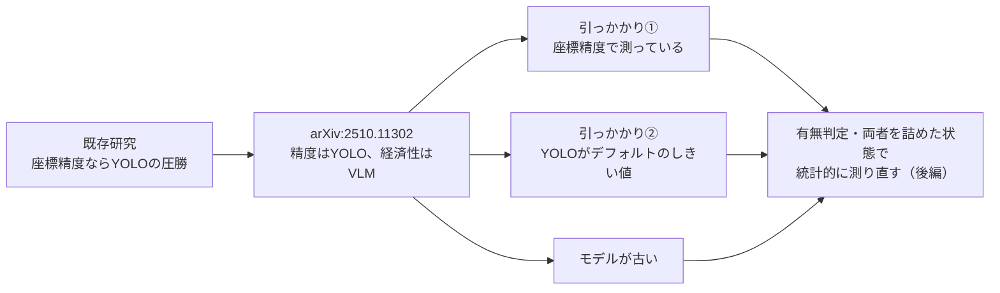

:::message
本記事は前後編の前編(背景編)です。前編では「なぜこの検証をしたのか」という問題意識を、既存研究を追いながら組み立てます。実際に自分で検証台を組んで統計的に検証した後編(実験編)は別記事です(末尾にリンク)。

🔗 **検証コード・再現手順**: [github.com/yuya0408/vlm-vs-yolo](https://github.com/yuya0408/vlm-vs-yolo)
:::

## この記事で分かること

配管・プラント設備の現場写真から「期待される部品が写っているか」を判定するタスクで、YOLOのような専用検出器と汎用VLMのどちらを使うべきかを検討した。既存研究は「精度ならYOLO、量が出ないならVLMが経済的」と結論づけるが、**その精度差は座標精度とデフォルトのしきい値で測ったもので、有無判定の土俵では測り直す必要がある**。



検証の結果は後編に書く。前編は、既存研究の何が自分のタスクに当てはまらないかを示す。

### 用語

| 用語 | 意味 |
| --- | --- |
| 専用検出器 | YOLO・SSD・Faster R-CNNなど、物体の位置を四角形(バウンディングボックス)で出すように学習したモデル |
| VLM | 視覚言語モデル(Gemini・GPT-4oなど)。画像と言葉を一緒に扱う |
| ゼロショット | 学習していないカテゴリを、言葉で指定して探すこと |
| 座標精度 | バウンディングボックスの位置の正しさ。Accuracy@IoU0.5は、正解の箱と半分以上重なれば正解とする |
| 有無判定 | 座標は問わず、そのカテゴリが画像に写っているかだけを判定すること |
| conf／NMSのIoU | YOLOの信頼度しきい値と、重なった検出をまとめるときのしきい値 |
| COCO | 80カテゴリの代表的な物体検出データセット |

---

## 1. 既存研究：座標精度ならYOLOの圧勝

**「精度」を座標精度で測る限り、YOLOの優位は動かない。** 2022年以降に蓄積された比較研究をまとめると、次のとおりだ。

| | 専用検出器(YOLOなど) | 汎用VLM |
| --- | --- | --- |
| 強い | 座標精度と推論速度 | 意味的な推論、ゼロショット検出 |
| 弱い | 学習していないカテゴリは検出できない | 座標を安定して出せない。専用のグラウンディングモデル(Qwen2.5-VLなど)でも、プロンプトの言い回しで座標精度が大きく振れる |
| 前提 | 大規模なデータセットで学習する | 学習しない |

私のタスクで問題だったのは座標精度ではなく、自ドメインに合う学習データだった。

| よくある誤解 | 実際の制約 |
| --- | --- |
| YOLOは配管設備を学習できない | Roboflow Universeなどに配管・バルブ・フランジのデータセットはあり、学習は原理的に可能 |
| — | 公開データが自社の撮影条件・部品仕様に合うとは限らず、合うデータを十分な量揃えるとアノテーションのコスト(2節の損益分岐)がかかる |

**制約は「学習が不可能」ではなく「割に合う規模でドメイン適応データを用意できない」ことだった。** だからゼロショットのVLMがYOLOに近い精度を出せるとありがたいが、既存研究を見る限りハードルは高い。

---

## 2. 最も参考にした論文：精度から損益分岐まで

2025年10月公開の *"When Does Supervised Training Pay Off? The Hidden Economics of Object Detection in the Era of Vision-Language Models"*(arXiv:2510.11302)は、COCO学習済みのYOLOとゼロショットのGemini Flash 2.5／GPT-4を比べ、アノテーションのコストまで積んで損益分岐を計算している。

| 観点 | YOLO(教師あり) | Gemini Flash 2.5(ゼロショット) | GPT-4(ゼロショット) |
| --- | --- | --- | --- |
| 標準カテゴリ精度(COCO 5000 枚) | **91.2%** | 68.5% | 71.3% |
| 語彙外カテゴリ精度(多様な製品画像 500 枚) | **0%**(構造的に検出不能) | 52.3% | 55.1% |

- 標準カテゴリでは、YOLOがGeminiに22.7ポイント、GPT-4に19.9ポイント差をつけた。
- 語彙外カテゴリでは逆転する。YOLOはCOCOの80カテゴリしか学習していないので0%になる。ただし語彙外のテストに使ったのは消費財の画像で、産業用の部品にそのまま当てはまるとは論文からは言えない。

```
100カテゴリの検出システムをアノテーションから作る費用 ≒ 1.08万ドル
Geminiの従量課金に対して割に合う点 ≒ 累計5,500万推論（毎日15万枚を1年処理し続ける規模）
```

**量が出ないなら、精度で負けていてもゼロショットVLMのほうが経済的に有利**、というのが論文の結論だ。私の実務を含め、大半の現場はそこまでの量を処理しない。

---

## 3. 引っかかり：この比較条件で本当にいいのか

| | 論文の条件 | 有無判定で問題になる点 | 予想 |
| --- | --- | --- | --- |
| ① 精度の土俵 | 座標精度(Accuracy@IoU0.5)で91.2% vs 68.5% | 座標はVLMが構造的に苦手な軸で、有無判定には要らない | 土俵を有無判定に移せば、20ポイントの差は縮む |
| ② YOLOのしきい値 | YOLOv8のデフォルト(conf=0.25、NMSのIoU=0.7)。VLMもプロンプトを詰めていない | conf=0.25は座標付きの検出向けの値で、有無判定に最適とは限らない。高めなら、自信のない検出を切り捨てて「写っている」を取りこぼす | 差の一部は実力差ではなく測定条件(しきい値)の差で、YOLOのしきい値を調整すると大きく動く |
| ③ モデルの世代 | YOLOv8、Gemini Flash 2.5、GPT-4 | 検証した2026年夏には、どちらも新しいモデルが出ている | 新しいモデルで比べるのが実務に近い |

「YOLOの方が実務向き」は、**測定条件を公平に揃えて初めて言えること**だ。既存研究の数字をそのまま意思決定に使うのは、腑に落ちるものではなかった。

---

## 4. 方針：現場の差を自分で測り直す

| 方針 | 内容 | ねらい |
| --- | --- | --- |
| 土俵を有無判定に統一する | 「そのカテゴリが画像に写っているか」だけを問う | YOLOを不利にするのではなく、VLMを不利にしていた軸(座標)を外す公平化 |
| 両モデルとも詰めた状態で比べる | VLMはプロンプト・温度を統制し、YOLOも信頼度しきい値を調整する | 片方だけデフォルト、という非対称を作らない |
| 統計的に有意差を判定する | McNemar検定とブートストラップ信頼区間 | 「なんとなくVLMが良さそう」で決めない |
| 業務データは使わない | 公開データ(COCO val2017)で同じ構造の問いを再現する。閉語彙・ラベルありの、YOLOに最も有利な条件 | 最良の条件のYOLOに、VLMがどこまで闘えるかを見る |

この4点はYOLOとVLMに固有のものではなく、比較評価を組むときに繰り返し使える型だ。

:::message
👉 **後編・実験編**: [YOLO vs VLM ── 汎用 VLM は本当に精度で劣るのか、統計で検証した【後編・実験編】](https://zenn.dev/yuya0408/articles/yolo-vs-vlm-evaluation-pitfall)
:::

---

## 補足①：スコープ外とした手法

| 手法 | 例 | 特徴 |
| --- | --- | --- |
| オープン語彙検出モデル | Grounding DINO / YOLO-World / OWL-ViT | テキストで任意のカテゴリを指定し、座標も出せる |
| オープンウェイトのVLM | Qwen2.5-VL / InternVL | セルフホストで運用できる |

どちらも専用検出器と汎用VLMの中間にあたる。本記事では、まず基本の対比を有無判定で見定めることを優先した。

---

## 補足②：論文の実験設定

後編の設定と見比べるために控えておく。**参照したのはv2(2025年10月20日)**で、表の数字はCOCO 5,000枚＋多様な製品画像500枚での評価だ(v1は1,000枚＋200枚で規模が違う)。

| 項目 | YOLO(教師あり側) | VLM(ゼロショット側) |
| --- | --- | --- |
| モデル | YOLOv8m(medium、約2,590万パラメータ) | Gemini Flash 2.5(主比較)、GPT-4 |
| 実装・推論 | Ultralytics v8.0.196。conf 0.25 / NMSのIoU 0.7 / 入力640×640 / T4 GPUでFP16 | 自然言語のクエリでカテゴリを指定 |
| 学習 | 追加のファインチューニングなし。COCO train2017で事前学習済みの既製重み(論文が「教師あり」と呼ぶのはこれ) | 学習しない |
| 備考 | — | v1の注記では、Claude 3.5を含む複数VLMに拡張した版をジャーナル投稿準備中としている |

| データ | 内容 |
| --- | --- |
| 学習(COCO train2017) | 80カテゴリ / 118,287枚 / 860,001個のバウンディングボックス |
| 評価(COCO val2017) | 物体サイズの分布を保つ層化サンプリング(小/中/大 = 20/40/40%、シード42) |

---

## 参考文献

- S. Al-Hamadani, *When Does Supervised Training Pay Off? The Hidden Economics of Object Detection in the Era of Vision-Language Models*, arXiv:2510.11302v2 (2025)
- *Object Detection with Multimodal Large Vision-Language Models: An In-depth Review*, arXiv:2508.19294 (2025)
- Ignit Group, *VLMs vs. object detection: A practical use case*(実務視点のブログ記事)

*※ 本検証で使用するデータは COCO val2017 および CC ライセンスの公開画像。業務データ・顧客固有情報は一切使用していません。*

---

この記事は前後編の2部構成です。

- **前編・背景編(本記事)**― なぜこの検証をしたのか、既存研究を追って問題意識を組み立てる話
- **後編・実験編**（[記事](https://zenn.dev/yuya0408/articles/yolo-vs-vlm-evaluation-pitfall)）― 有無判定の土俵で、しきい値を公平に調整して統計的に比較し直す話
<!-- gbrain: [Source: User, 記事執筆・公開, 2026-09-13] -->
