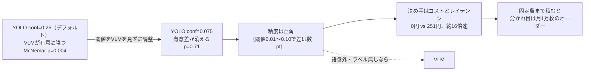
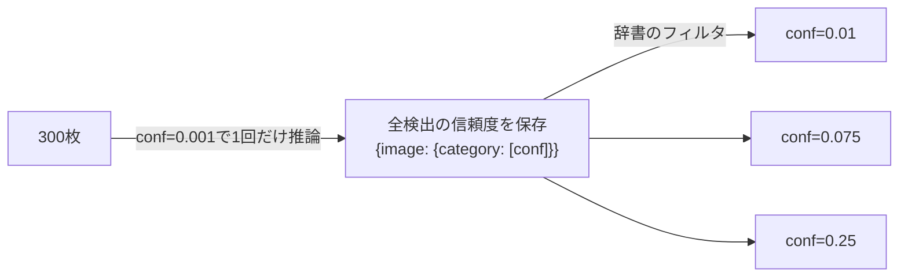
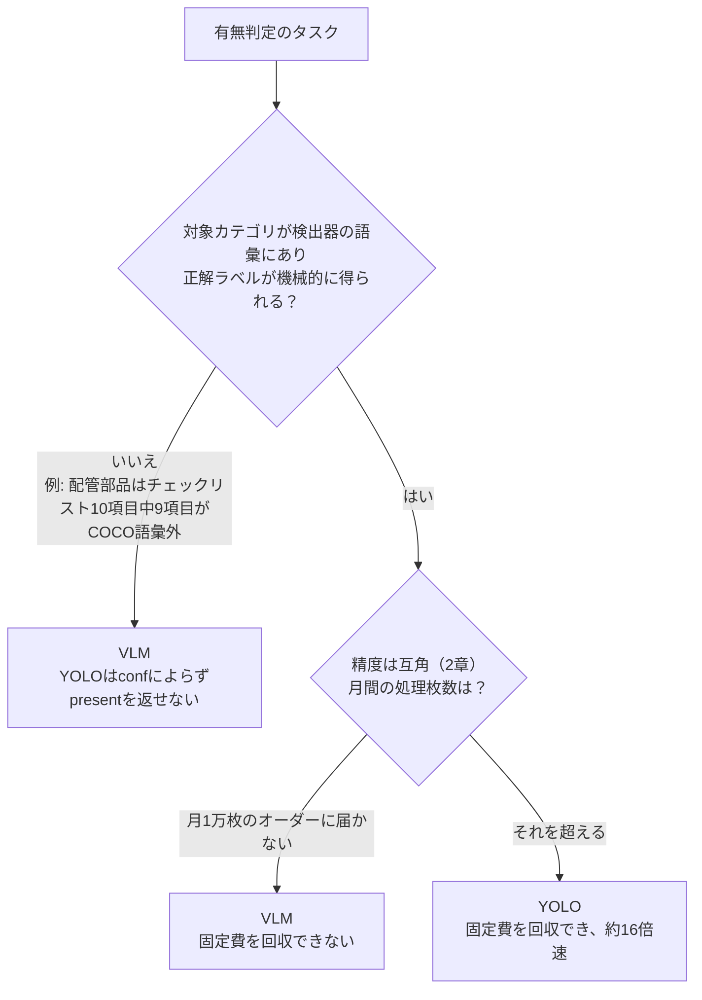

:::message
本記事は前後編の後編(実験編)である。「なぜこの検証をしたのか」という問題意識・既存研究の整理は前編(背景編)にまとめてある(冒頭にリンク)。本記事は単独でも読めるが、動機の背景は前編を参照してほしい。

👉 **前編・背景編**: [YOLO vs VLM ── 画像検出タスクに向いているのはどちらなのか【前編・背景】](https://zenn.dev/yuya0408/articles/yolo-vs-vlm-background)

🔗 **検証コード・再現手順**: [github.com/yuya0408/vlm-vs-yolo](https://github.com/yuya0408/vlm-vs-yolo)
:::

## この記事で分かること

COCOの有無判定で、YOLOとGemini Flashを統計的に比べ直した。**同じデータ・同じ指標でも、YOLOの信頼度閾値をデフォルトのままにするか調整するかだけで、統計的な結論が反転した**。「統計的検定を通したのに間違っていた」比較評価の記録である。



| 比較 | 結果 |
| --- | --- |
| YOLO(デフォルト conf=0.25) vs VLM | VLMが有意に上(McNemar p=0.004) |
| YOLO(調整後 conf=0.075) vs VLM | 有意差なし(p=0.71)。閾値0.01〜0.10のどこでも差は数pt以内 |
| VLMのプロンプトを3水準振る | どれもYOLOとの有意差なし。結論は変わらない |
| 損益分岐(YOLOに最も有利な下限) | 月500枚では回収不能。分かれ目は月間1万枚のオーダー |

### 用語

| 用語 | 意味 |
| --- | --- |
| 判定項目 | (画像, カテゴリ)の1組。全体で2,281項目(画像300枚 × チェックリスト5〜10項目) |
| GT | Ground Truth。正解データ(present / absent の2値) |
| strict | 予測のuncertainを見逃し(FN)として数える集計。VLMの逃げ道を塞いだ状態 |
| micro-F1 | 全カテゴリのTP/FP/FNを足してから1回だけF1を計算する。項目数の多いカテゴリの影響が大きい |
| macro-F1 | カテゴリごとにF1を出してから単純平均する。出現数3件のカテゴリも200件のカテゴリも同じ重み |
| item accuracy | 正解した判定項目数 ÷ 全判定項目数 |
| 個数recall | 個数の再現率(副軸) |
| n01／n10 | McNemar検定で使う、YOLOだけ正解した項目数／VLMだけ正解した項目数 |

---

## 条件

| 項目 | 内容 |
| --- | --- |
| タスク | 写真と「期待される項目のリスト」を渡し、各項目を present / absent / uncertain で返す |
| YOLOの出力の扱い | 「そのカテゴリを閾値以上で1個でも検出したか」でpresent / absentにする。bboxの座標は比較に使わない(座標の勝負にするとVLMが不当に不利になる) |
| データ | COCO val2017からN=300を層化サンプリング(物体数・最小bbox面積比で層化)。全カテゴリがCOCO 80クラスに収まる、YOLOのホームグラウンド |
| YOLO | `yolo26x`、COCO学習済み重み、ローカル推論 |
| VLM | `gemini-3.5-flash`、temp=0、レスポンスはキャッシュ。プロンプトは1本(`concise`、迷ったらuncertainを優先する指示)に固定 |

| 統計 | やり方 | 理由 |
| --- | --- | --- |
| 95%信頼区間 | 画像単位のブートストラップ(10,000回、percentile法) | 同じ画像の項目は独立ではない(暗い画像なら10項目まとめて外しやすい)。項目単位でリサンプルすると区間が不当に狭くなる |
| 検定 | 対応ありのMcNemar検定 | 2つのモデルは同じ2,281項目を解いている。答えが割れた項目だけを見て、「割れたときの勝ち負けは五分五分」を帰無仮説にする |

集計は(GT, 予測)の6セルで数える。presentをpositiveとして、TP=`pp`、FP=`ap`、FN=`pa`+`pu`。**`pu`をFNに入れるのがstrictの正体**だ。

| | 予測 present | 予測 absent | 予測 uncertain |
|---|---|---|---|
| **GT present** | `pp`(正解) | `pa`(見逃し) | `pu` |
| **GT absent** | `ap`(偽陽性) | `aa`(正解) | `au` |

---

## 1. デフォルトのままの比較：専用検出器の本拠地で、汎用VLMが有意に勝った

| 指標 | YOLO(conf=0.25 既定) | VLM(`gemini-3.5-flash`) |
|---|---|---|
| macro-F1 (strict) [95%CI] | 0.906 [0.878, 0.933] | 0.961 [0.940, 0.970] |
| McNemar | n01=30, n10=58, **p=0.004** | — |
| 個数 recall(副軸) | 0.767 | 0.871 |

CIは重ならず、McNemarも有意。閉語彙＝専用検出器の学習ドメインでの有無判定なのに、汎用VLMが精度で勝つ結果だ。

---

## 2. YOLOの閾値を調整した再比較：有意差が消える

**VLMはプロンプトを設計しtemp=0で使っているのに、YOLOはデモ用の既定値のままだった。** これは「調整済み vs 未調整」の比較で、しかもconf=0.25は座標付き検出向けの値で、有無判定に最適である理由が無い。

### 推論は1回、閾値は後処理



```python
def capture_detections(eval_set, weights, images_dir, base_conf=0.001):
    """各画像をローカル推論し {image_id: {category: [confidences]}} を返す。"""
    provider = YoloProvider(weights=weights, conf_threshold=base_conf)
    raw = {}
    for e in eval_set:
        raw[str(e["image_id"])] = provider.detect_confidences(path, base_conf=base_conf)
    return {"weights": weights, "base_conf": base_conf, "detections": raw}

def judge_at(confs_by_cat, category, t):
    n = sum(1 for c in confs_by_cat.get(category, []) if c >= t)
    return "present" if n > 0 else "absent"
```

信頼度閾値は推論後のフィルタでしかないので、推論は1回で済み、グリッドの追加・変更は事実上無料になる。

### 指標によって最適閾値が割れる

| conf | macro-F1 | micro-F1 | item accuracy | 個数 recall |
|---|---|---|---|---|
| 0.01 | **0.945** | 0.941 | 0.962 | 0.985 |
| 0.075 | 0.929 | **0.954** | **0.972** | 0.927 |
| 0.25(既定) | 0.906 | 0.934 | 0.961 | 0.767 |

| 閾値を下げると | macro-F1 | micro-F1 |
| --- | --- | --- |
| 稀なカテゴリが拾えて、F1が0→0.8のように跳ねる | 等重みで拾うので上がる | — |
| 偽陽性が全体で増える | — | 頭数で食らって下がる |

**macro-F1を単独で最大化しにいくと騙される。**

### 操作点は「テストで選んでテストで報告」を避けて決める

操作点は、F1-confカーブのピークを運用閾値とする検出器側の定石だけで決めた(VLMのスコアは見ない)。300件をtune(120)/test(180)に分け、tuneだけでmicro-F1・item accuracyを最大化しても**0.075**、全データのargmaxも0.075だった。

### 再比較の結果

| 指標 | YOLO@0.075 | VLM(`gemini-3.5-flash`) | 判定 |
|---|---|---|---|
| macro-F1 (strict) [95%CI] | 0.929 [0.912, 0.960] | 0.961 [0.940, 0.970] | CI 重複 |
| McNemar(全 300) | n01=30, n10=34 | — | **p=0.71 → 有意差なし** |
| McNemar(リークなし test, N=180) | n01=22, n10=16 | — | p=0.42(micro-F1 では YOLO 逆転 0.959 vs 0.954) |
| 個数 recall | 0.927 | 0.871 | YOLO |
| コスト(300 枚) | **0 円** | 251 円 | YOLO |
| レイテンシ中央値 | **0.33 秒** | 5.42 秒 | YOLO 約 16 倍速 |

動かしたのはYOLO側のスカラー1つだけで、データもプロンプトも指標も1章と同じだ。

### 有意差の正体：YOLOが一方的に献上していた失点

閾値を0.25→0.075に下げても、n01(YOLOだけ正解)は30のままで、減ったのはn10(VLMだけ正解)だけだった。

```
YOLOの誤答: 88 → 64（present の取りこぼしを43項目回収、新たな偽陽性が19項目）
n10 = 58 − 36（回収した43項目のうち、VLMは正解していた項目） + 12（新たな偽陽性のうち、VLMは正解の項目） = 34
n01 = 30 → 30（件数は同じだが、中身は7項目入れ替わっている）
```

| | 割れた項目 | たとえると | p |
| --- | --- | --- | --- |
| conf=0.25 | 30 vs 58 | コイン88回で表58回 → 偶然としては苦しい | 0.004 |
| conf=0.075 | 30 vs 34 | コイン64回で表34回 → 普通に起こる | 0.71 |

閾値が高すぎたせいでYOLOが落としていた項目が、そのまま統計的有意差の正体だった。

### 結論を一点に依存させない

| 指標 | YOLO(conf 0.01〜0.10 での範囲) | VLM | 差 |
|---|---|---|---|
| macro-F1 (strict) | 0.921 – 0.945 | 0.961 | 1.6 – 4.0 pt |
| micro-F1 (strict) | 0.941 – 0.954 | 0.959 | 0.5 – 1.8 pt |

**妥当な閾値・どの指標でも差は数pt以内**で、「精度はほぼ互角」は操作点の置き方で揺らがない。ただし留保が2つある。

| 留保 | 内容 |
| --- | --- |
| 有意性は端で揺らぐ | 下端conf=0.01ではMcNemarが再び有意(n01=26, n10=53, p=0.003、VLM優位)。macro-F1を貪欲に最大化する退化点で、有無判定には座標由来の偽陽性の罰則が無いためrecallに振り切れ、項目単位で偽陽性が積み上がる。conf=0.025〜0.10では一貫して非有意(p=0.11〜0.71)で、0.075はその内側にある。だから操作点はVLMのスコアを見ずに先に決める |
| 有意差なし ≠ 同等の証明 | リークなしtestはN=180で検出力が限られ、言えるのは「この標本サイズでは差を検出できなかった」まで。「互角」は、非有意に加えて点差とCIの幅が数ptに収まることまで見た判断 |

---

## 3. VLM側のプロンプトはどこまで詰められるか

**主比較で詰めたのはYOLO側だけで、VLMのプロンプトは同じようには詰められない。** 探索空間の性質が根本的に違う。

| | YOLOの閾値 | VLMのプロンプト |
| --- | --- | --- |
| 探索空間 | [0, 1]のスカラー1つ。グリッドで全走査でき「全部試した」と言える | 次元も境界も無い。何本か試すのは探索ではなく標本抽出 |
| 1点のコスト | 推論後のフィルタなので無料・即時 | 入力なので1点ごとにN=300の推論をやり直す(1回251円、20本で約5,000円) |
| 再現性 | 決定論的 | temp=0でもAPIの完全な決定性は保証されない。プロンプトを変えるたびに比較の基準を引き直すことに近い |

全走査はできないので、プロンプトを3水準振り、**結論(精度は互角 → 決定はコスト/レイテンシ)が反転しないか**を確かめた。

| 水準 | 何を変えるか |
|---|---|
| `concise`(baseline) | 本編(初回推論)で使った現行プロンプト |
| `deliberate` | 項目ごとに根拠を先に書かせてから判定させる(もっとも標準的な改善レバー) |
| `calibrated` | 過剰主張を抑える指示 + uncertain の使用基準を明示 |

実際に使ったプロンプト全文(**実行時にAPIへ送信したのは英語原文**で、以下は日本語訳):

:::details concise(baseline)
```text
あなたは精密な視覚検査官です。1枚の画像と、対象カテゴリのチェックリストが与えられます。
チェックリストの各カテゴリについて、その物体が画像内に写っているかを判定してください。

ルール:
- 判断は画像内の視覚的な証拠のみに基づくこと。チェックリストには画像に写っていない物体が
  含まれている場合がある——リストに載っているからといって写っていると決めつけないこと。
- "present"(写っている): その物体のインスタンスを少なくとも1つ、はっきり確認できる場合。
- "absent"(写っていない): その物体が写っていないと確信できる場合。
- "uncertain"(判定不能): 本当に判断がつかない場合(強い遮蔽、小さすぎる/ぼやけている、
  曖昧など)。自信が持てないときは、当て推量よりuncertainを優先すること。
- count(個数): "present"の場合のみ、見えるインスタンスのおおよその整数個数を記載する
  (ベストエフォート)。この値はpresent/absent/uncertainの判定自体には影響しない。
  "absent"・"uncertain"の場合はnullとする。
- rationale(根拠): 見た内容を示す短いフレーズ(最大8語程度)。

出力は厳密なJSONのみ——チェックリストの各項目につき1オブジェクトを含むJSON配列とする:
[{"category": "<チェックリストの名称そのまま>",
  "judgement": "present" | "absent" | "uncertain",
  "count": <整数またはnull>,
  "rationale": "<短いフレーズ>"}]
カテゴリ名はチェックリストと完全一致させること。チェックリストの各項目を必ず1回ずつ含める。
余分な項目は不可。JSON以外のテキストは出力しない。

Checklist: {checklist}
```
:::

:::details deliberate(reason-then-answer)── concise との差分(緑=追加、赤=削除)
```diff
  あなたは精密な視覚検査官です。1枚の画像と、対象カテゴリのチェックリストが与えられます。
  チェックリストの各カテゴリについて、その物体が画像内に写っているかを判定してください。

+ 手順(この順序で行うこと):
+ 1. まず画像全体を見て、実際にそこに何があるかをメモする——前景・背景を問わず、
+    部分的に隠れた物体や小さい物体も含める。
+ 2. 次にチェックリストの項目を1つずつ処理する。各項目について、画像内で実際に
+    指し示せる視覚的証拠を述べてから(見つからない場合はその旨を述べてから)判定する。
+ 3. チェックリストにステップ1の判断を誘導させないこと。チェックリストは画像を見ずに
+    作成されており、意図的に画像に写っていない物体を含んでいる。

  ルール:
- - 判断は画像内の視覚的な証拠のみに基づくこと。チェックリストには画像に写っていない物体が
-   含まれている場合がある——リストに載っているからといって写っていると決めつけないこと。
+ - 判断は画像内の視覚的な証拠のみに基づくこと。
  - "present"(写っている): その物体のインスタンスを少なくとも1つ、はっきり確認できる場合。
  - "absent"(写っていない): その物体が写っていないと確信できる場合。
  - "uncertain"(判定不能): 本当に判断がつかない場合(強い遮蔽、小さすぎる/ぼやけている、
    曖昧など)。自信が持てないときは、当て推量よりuncertainを優先すること。
  - count(個数): "present"の場合のみ、見えるインスタンスのおおよその整数個数を記載する
    (ベストエフォート)。この値は判定自体には影響しない。"absent"・"uncertain"の場合はnull。
+ - evidence(証拠): 判定する前に、この項目について実際に見えているものを記述する
+   (最大15語程度)。先にこれを書き、judgementはそこから導かれるものであること。
  - rationale(根拠): 見た内容を示す短いフレーズ(最大8語程度)。

- 出力は厳密なJSONのみ——チェックリストの各項目につき1オブジェクトを含むJSON配列とする:
+ 出力は厳密なJSONのみ——チェックリストの各項目につき1オブジェクト、
+ "evidence"を"judgement"より先に書いたJSON配列とする:
  [{"category": "<チェックリストの名称そのまま>",
+   "evidence": "<この項目について実際に見えているもの>",
    "judgement": "present" | "absent" | "uncertain",
    "count": <整数またはnull>,
    "rationale": "<短いフレーズ>"}]
  カテゴリ名はチェックリストと完全一致させること。チェックリストの各項目を必ず1回ずつ含める。
  余分な項目は不可。JSON以外のテキストは出力しない。

  Checklist: {checklist}
```
:::

:::details calibrated(過剰主張の抑制 + uncertain基準の明示)── concise との差分(緑=追加、赤=削除)
```diff
  あなたは精密な視覚検査官です。1枚の画像と、対象カテゴリのチェックリストが与えられます。
  チェックリストの各カテゴリについて、その物体が画像内に写っているかを判定してください。

+ チェックリストは画像を見ずに生成されている。その多くの項目は画像に全く写っておらず、
+ 一部は画像に写っているものの見間違えやすい近縁カテゴリである(例: 車の画像に対して
+ "truck"、犬の画像に対して"cat"が挙がっている等)。リストに載っていること自体は
+ 証拠にならない。単語がリストにあるという理由だけで推測を"present"に格上げしないこと。

- ルール:
- - 判断は画像内の視覚的な証拠のみに基づくこと。チェックリストには画像に写っていない物体が
-   含まれている場合がある——リストに載っているからといって写っていると決めつけないこと。
- - "present"(写っている): その物体のインスタンスを少なくとも1つ、はっきり確認できる場合。
- - "absent"(写っていない): その物体が写っていないと確信できる場合。
- - "uncertain"(判定不能): 本当に判断がつかない場合(強い遮蔽、小さすぎる/ぼやけている、
-   曖昧など)。自信が持てないときは、当て推量よりuncertainを優先すること。
+ 判定基準:
+ - "present"(写っている): 実際に見えているインスタンスを少なくとも1つ指し示せる場合。
+   「たぶんある」「それらしきものがある」という推論であれば、それはpresentではない。
+ - "absent"(写っていない): 探したが見つからなかった場合。何も見つからない時のデフォルトの
+   回答はこれである——画像が煩雑だからという理由だけでuncertainに切り替えないこと。
+ - "uncertain"(判定不能): それらしきものは見えるが、何であるか判断できない場合
+   (強い遮蔽、小さすぎる/ぼやけている、本当に曖昧など)。present と absent のどちらか
+   賭けることになる場合は必ずこれを使う——おおまかには、自分の回答に賭けられない場合すべて。
+   決断力があるように見せるためにuncertainを抑制しないこと。
+ - 近縁カテゴリはpresentではなくabsentとする: 車が見えていて項目が"truck"なら、
+   truckはabsentと回答する。
  - count(個数): "present"の場合のみ、見えるインスタンスのおおよその整数個数を記載する
    (ベストエフォート)。この値は判定自体には影響しない。"absent"・"uncertain"の場合はnull。
  - rationale(根拠): 見た内容を示す短いフレーズ(最大8語程度)。

  出力は厳密なJSONのみ——チェックリストの各項目につき1オブジェクトを含むJSON配列とする:
  [{"category": "<チェックリストの名称そのまま>",
    "judgement": "present" | "absent" | "uncertain",
    "count": <整数またはnull>,
    "rationale": "<短いフレーズ>"}]
  カテゴリ名はチェックリストと完全一致させること。チェックリストの各項目を必ず1回ずつ含める。
  余分な項目は不可。JSON以外のテキストは出力しない。

  Checklist: {checklist}
```
:::

実行前に決めた規則：

| 規則 | 内容 |
| --- | --- |
| 選び方 | tune(120)でmicro-F1が最大の水準を選び、test(180)で報告する(YOLOの閾値選定と同じ) |
| 合否の線 | プロンプト間のばらつき(max−min)が、YOLOの閾値選びで既に許容している振れ幅(0.921–0.945 = 2.4pt)を超えないこと |

結果(全 300):

| 水準 | macro-F1 | micro-F1 | item acc | コスト(円) |
|---|---|---|---|---|
| **concise(baseline)** | 0.9613 | 0.9593 | 0.9737 | 251 |
| deliberate | 0.9635 | 0.9620 | 0.9724 | 312 |
| calibrated | 0.9589 | 0.9558 | 0.9702 | 260 |

ばらつきはmacro-F1で0.46pt・micro-F1で0.62ptで、**事前の線(2.4pt)を超えなかった**(3点の標本なので、プロンプト空間の真の振れ幅ではない)。tuneでmicro-F1最大の水準は`concise`自身だった。

tuned YOLO@0.075との対応あり比較(リークなしtest N=180。全300での差3.2ptとは母集団が違う):

| VLM プロンプト | macro-F1 差(VLM−YOLO, test N=180) | McNemar p(項目単位) | 有意(5%) |
|---|---|---|---|
| concise(選定, 事前登録どおり) | +1.69pt | 0.42 | NO |
| deliberate(参考, 選定外) | +2.03pt | 0.27 | NO |
| calibrated(参考, 選定外) | +1.89pt | 0.20 | NO |

**結論は変わらない。** ただし「両者を同じ熱量で調整する」という原則は、探索空間の性質が違いすぎると同じ意味では実行できない。専用モデルと汎用モデルを公平に比べること自体が抱える、構造的な難点だ。

---

## 4. 損益分岐：「YOLOは0円」の本当の意味

**「0円」はAPI課金が0というだけで、実際にはアノテーション・学習工数・推論基盤の運用が固定費として先に立つ。** 技術選定で効くのは、固定費先行(YOLO)と従量課金(VLM)の交点だ。

```
YOLO 累計(T ヶ月) = 固定費 + 運用月額 × T
VLM  累計(T ヶ月) = 0.84 円/枚(実測) × 月間枚数 × T
```

(単価は実測の 251 円 ÷ 300 枚 = 0.8367 円/枚。以下の計算はこの丸めない値で行っている)

YOLOの固定費は環境依存なので、**公開値の中で最も安い条件＝YOLOに最も有利な下限**を置く。下限で結論が出れば、実際の条件では結論が補強される方向にしか動かない。

| 項 | 置いた値(下限) | 実際にはこちらに動きうる |
|---|---|---|
| 矩形単価 | 5.8 円(クラウドソーシング最安、$0.036/object) | 国内外注の相場は 10 円〜、有識者の内製なら時給換算で約 35 円 |
| ラベル枚数 | 3,000 枚(10 クラス × 300 枚) | Ultralytics 推奨(≧1,500 枚/クラス)なら 15,000 枚 |
| 運用月額 | 0 円(既存基盤に相乗り) | 専用の推論サーバ・監視を持てば月数万円 |

```
固定費(下限) = ラベル費 104,400円 + 学習工数 240,000円 = 344,400円
  ラベル費 = 3,000枚 × 矩形5個/枚 × 5.8円 × 手戻り係数1.2
  学習工数 = 40時間 × 6,000円/時
```

手戻り係数・矩形数・工数・時給は出典のない仮定なので、各自の数字に差し替えて読んでほしい。「回収不能」は、VLMの月額がYOLOの運用月額を上回らず交点が無いか、120ヶ月超を指す。

| 固定費 | 500 枚/月 | 5,000 枚/月 | 50,000 枚/月 | 500,000 枚/月 |
|---|---|---|---|---|
| 下限(×1) 34 万円 | **回収不能** | 82.3 ヶ月 | 8.2 ヶ月 | 0.8 ヶ月 |
| ×3(103 万円) | **回収不能** | **回収不能** | 24.7 ヶ月 | 2.5 ヶ月 |
| ×10(344 万円) | **回収不能** | **回収不能** | 82.3 ヶ月 | 8.2 ヶ月 |


「×3」「×10」は固定費への一律倍率の感度確認で、運用月額は常に0円のまま(月数万円のシナリオは計算していない)。

| 読み | 内容 |
| --- | --- |
| 月数百〜数千枚 | 最も安い条件でも回収できない。下限の損益分岐は累計41万枚で、月500枚なら約68年 |
| 月5万枚超 | 下限なら8ヶ月で回収圏。36ヶ月以内の回収に要る月間枚数は11,434枚で、**判断を見直す閾値は月間1万枚のオーダー** |
| 最大の不確実性 | ラベルN枚で目標精度に届く保証は確かめていない(fine-tuningはスコープ外)。届かなければ固定費はさらに膨らむ |
| 逆方向の確認 | アノテーション費を0円に振り切っても(AI支援でどこまで下がるかは出典を揃えられなかった)、固定費は24万円、累計の損益分岐は41万枚→29万枚、36ヶ月回収に要る枚数は11,434枚→7,968枚にしか動かない。結論は変わらないが、この方向では判断がYOLO寄りに動く |

---

## 5. 結論

有意差が消えたことで、意思決定の軸が精度からコストとタスクの特性に移った。



「専用 vs 汎用」は優劣ではなく、タスクの特性(語彙内・ラベルあり / 語彙外・ラベル無し)と処理量で決まる。前編の見立ては数字で裏づけられた。**比較評価の結論は「どちらが勝ったか」より「その勝敗がどの条件の産物か」の方に価値がある。**

---

この記事は前後編の2部構成である。

- **前編・背景編**([記事](https://zenn.dev/yuya0408/articles/yolo-vs-vlm-background)) ― なぜこの検証をしたのか、既存研究を追って問題意識を組み立てる話
<!-- gbrain: [Source: User, 記事執筆・公開, 2026-09-13] -->
- **後編・実験編(本記事)**― 有無判定の土俵で、閾値を公平に調整して統計的に比較し直す話
